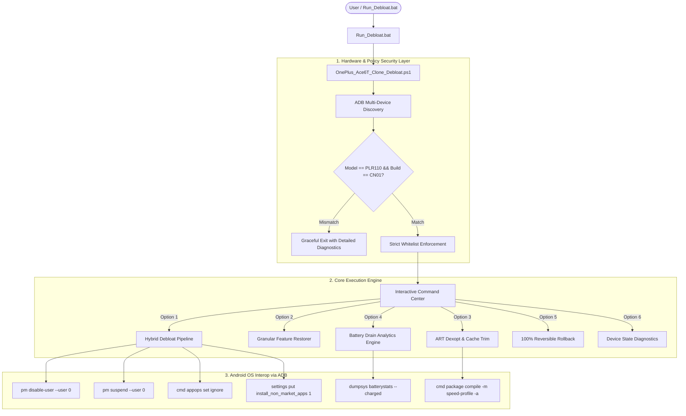

# Architecture & Engineering Design

This document details the internal architecture, subsystem communication, and safety pipelines of **AceDebloat**.

---

## 1. High-Level System Architecture

---

## 2. Component Breakdown

### 2.1. Hardware & Region Validation Guard
To eliminate accidental bricking or unintended profile application on unsupported hardware:
1. `ro.product.model` is verified against the targeted target string (`PLR110`).
2. `ro.build.display.id` or `ro.build.version.incremental` is verified against the Chinese regional release token (`CN01`).
3. If an unrecognized device or multi-device emulator collision occurs, execution is immediately paused, logging explicit diagnostics.

### 2.2. Hybrid Deactivation Pipeline
Modern ColorOS enforces tiered restrictions on package lifecycle management:
1. **Standard System Applications**: Controlled via `pm disable-user --user 0`. The Android Package Manager sets `COMPONENT_ENABLED_STATE_DISABLED_USER` (state `2`).
2. **Hardened Vendor Applications**: Packages like `com.heytap.market` and `com.heytap.browser` are protected against `pm disable-user`. AceDebloat shifts to `pm suspend --user 0` (Package Suspended State), freezing process lifecycles.
3. **AppOps Hardening**: To prevent suspended packages from waking via BroadcastReceivers or AlarmManager, permissions (`RUN_IN_BACKGROUND`, `RUN_ANY_IN_BACKGROUND`, `POST_NOTIFICATION`, `BOOT_COMPLETED`) are explicitly overridden to `ignore`.
4. **Package Installer Decoupling**: Disabling `com.oplus.appdetail` bypasses Chinese account validation prompts on `.apk` installations, falling back to Android's clean package installer.

### 2.3. Granular Feature Restorer Subsystem
ColorOS embeds several UI-facing capabilities into specific package clusters:
- **Fluid Cloud («Остров»)**: Dependent on `com.coloros.ocs.opencapabilityservice`, `com.oplus.smartmediacontroller`, `com.oplus.smartengine`, `com.oplus.aiwidgets`, `com.oplus.metis`, and `com.coloros.sceneservice`.
- **Always-On Display (AOD)**: Governed by `com.oplus.aod`.
- **3-Finger Screenshots & Recorder**: Dependent on `com.oplus.screenshot` and `com.oplus.screenrecorder`.
- **Game Toolkit (HyperBoost)**: Powered by `com.oplus.games`.

The Granular Restorer allows immediate reinstatement of any cluster through an intuitive numerical menu without disturbing the remaining debloat profile.

### 2.4. Battery Profiler Subsystem
Rather than relying on inaccurate percentage estimates, AceDebloat queries Android's low-level `dumpsys batterystats`. It extracts:
- Discharge step intervals.
- App UID power consumption ratings in milliamp-hours (**mAh**).
- Top background drain sources sorted in descending order.
