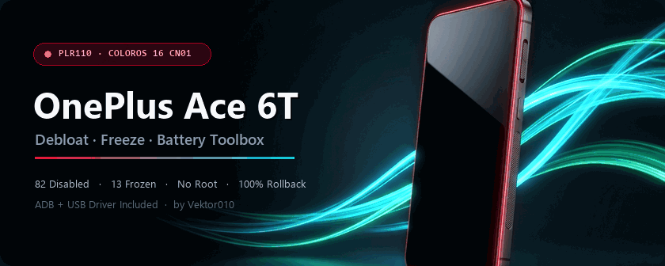

<p align="center">
  
</p>

<p align="center">
  
</p>

<h1 align="center">⚡ OnePlus Ace 6T (PLR110) Debloat &amp; Optimization</h1>

<p align="center">
  <b>Комплексная очистка смартфона от китайского софта, заморозка неудаляемых служб и анализ расхода батареи.</b><br/>
  <i>Специально для OnePlus Ace 6T (ColorOS 16 CN01) · Без Root · 100% обратимо · ADB и драйверы уже внутри архива. By <b>Vektor010</b>.</i>
</p>

<p align="center">
  <a href="https://github.com/Vektor010/oneplus-ace-6t-debloat/releases/latest"></a>&nbsp;&nbsp;
  <a href="#-быстрый-старт-за-3-шага-для-новичков"></a>&nbsp;&nbsp;
  <a href="#-где-безопасно-брать-приложения-google-play-rustore-и-чистые-apk"></a>&nbsp;&nbsp;
  <a href="#-как-вернуть-остров-fluid-cloud-и-другие-фичи"></a>&nbsp;&nbsp;
  <a href="#-справочник-всех-95-пакетов"></a>
</p>

<p align="center">
  
  
  
  
  
</p>

---

## 💡 Зачем это нужно? (Было / Стало)

В китайской версии **OnePlus Ace 6T (ColorOS 16 CN)** прямо из коробки работает огромное количество фоновых служб, созданных для Китая: китайский поисковик Baidu, магазин App Market, голосовой помощник Breeno, рекламные SDK и трекеры.

| До оптимизации (Заводская прошивка) | После оптимизации этим инструментом |
| :--- | :--- |
| ❌ **~140 фоновых процессов**, нагружающих память и процессор |  **Минус 95 процессов**: система разгружена, память свободна |
| ❌ **Утечка батареи ночью (8–12%)** из-за постоянных запросов в Китай |  **Расход ночью 1–2%**: телефон честно спит в глубоком сне (Deep Sleep) |
| ❌ Китайские всплывающие пуши, реклама в шторке и меню |  **Полная тишина**: реклама Oppo Ads и спам-сервисы заморожены |
| ❌ Неудаляемый браузер HeyTap и магазин приложений |  **Заморожены**: не открываются по ошибке и не будят процессор |
| ❌ Проверки безопасности APK и запросы китайских паролей |  **Мгновенная чистая установка APK** напрямую через систему |
| ❌ Случайные микрофризы при переключении тяжелых программ |  **+1.5–2 часа работы экрана** и плавная анимация (ART speed-profile) |

---

## 🚀 Быстрый старт за 3 шага (для новичков)

> [!NOTE]
> **Вам ничего не нужно искать и скачивать отдельно.**  
> В готовом архиве уже лежит настроенный портативный **ADB** (`platform-tools`), официальный **USB-драйвер**, удобный лаунчер запуска в 1 клик (`Run_Debloat.bat`) и текстовая инструкция.

### Шаг 1. Скачайте и распакуйте архив
1. Нажмите зелёную кнопку **[Скачать архив v1.0.0](https://github.com/Vektor010/oneplus-ace-6t-debloat/releases/latest)** (`OnePlus_Ace6T_Debloat_Tool.zip`).
2. **Обязательно распакуйте архив** в отдельную папку на компьютере *(Правый клик по архиву ➔ «Извлечь все...»)*.  
   *(Не запускайте скрипт прямо из окна архиватора WinRAR / 7-Zip!)*

### Шаг 2. Включите отладку по USB на телефоне
1. Откройте **Настройки** ➔ **Об устройстве** ➔ **Версия**.
2. Быстро нажмите **7 раз подряд** на пункт **«Номер сборки»** и введите ваш пароль разблокировки. Появится уведомление: *«Вы стали разработчиком»*.
3. Вернитесь в **Настройки** ➔ **Дополнительные настройки** *(или Система)* ➔ **Для разработчиков**.
4. Включите пункт **«Отладка по USB»** (USB debugging).
5. *(Рекомендуется)* Пролистайте чуть ниже и включите **«Отключить мониторинг разрешений»**.

### Шаг 3. Подключите к ПК и запустите скрипт
1. Подключите OnePlus Ace 6T к ПК родным кабелем Type-C и разблокируйте экран.
2. В шторке смартфона выберите режим USB **«Передача файлов»** *(не «Только зарядка»)*.
3. Запустите файл **`Run_Debloat.bat`** двойным кликом *(если Windows SmartScreen покажет синее окно — нажмите «Подробнее» ➔ «Выполнить в любом случае»)*.
4. **Посмотрите на экран смартфона:** появится запрос *«Разрешить отладку по USB?»* — поставьте галочку **«Всегда разрешать с этого компьютера»** и нажмите **«Разрешить»**.
5. В окне программы нажмите **`1`** (Очистить и оптимизировать) ➔ подтвердите цифрой **`1`**.
6. Через 20 секунд процесс завершится. Согласитесь на оптимизацию приложений и перезагрузите смартфон.

<details>
<summary><b>Что делать, если компьютер не видит телефон (Установка драйвера)</b></summary>
<br>

В **Windows 10 и 11** драйвер (`WinUSB`) уже встроен, поэтому в 95% случаев телефон распознаётся сразу. Если соединение не появляется:
1. **Способ 1 (Встроенный в телефон диск):** откройте «Этот компьютер» ➔ найдите виртуальный CD-привод `OnePlus Drivers` ➔ запустите установщик `OnePlus_USB_Drivers_Setup.exe`.
2. **Способ 2 (Драйвер из нашего архива):** нажмите `Win + X` ➔ **Диспетчер устройств** ➔ найдите устройство с жёлтым треугольником (`OnePlus` / `ADB Interface`) ➔ ПКМ ➔ **Обновить драйвер** ➔ **Найти на этом компьютере** ➔ **Выбрать из списка доступных** ➔ **Показать все устройства** ➔ **Установить с диска...** ➔ выберите файл `Drivers\usb_driver\android_winusb.inf` ➔ нажмите **Android ADB Interface**.

</details>

---

## 🛍️ Где безопасно брать приложения (Google Play, RuStore и чистые APK)

В китайской версии **ColorOS 16 / 17 (CN)** нет предустановленного Google Play Маркета, а китайский App Market перегружен рекламой и китайским софтом.  
Новички часто теряются и качают сомнительные APK с вирусами. **Вот проверенная инструкция, как за 2 минуты настроить чистую работу всех приложений:**

### 1. Как включить Google-сервисы и установить официальный Google Play Маркет
В ColorOS базовый фреймворк Google **уже встроен в прошивку**, его не нужно прошивать через кастомное рекавери. Достаточно активировать тумблер:
1. Откройте **Настройки** ➔ **Пользователи и аккаунты** ➔ выберите пункт **Службы Google Mobile (GMS)** ➔ переведите тумблер во **Включено**.
2. Скачайте **официальный чистый APK Google Play Маркета** с проверенного мирового каталога [**APKMirror (Google Play Store)**](https://www.apkmirror.com/apk/google-inc/google-play-store/):
   * Выбирайте последнюю стабильную версию (метка **Release**, не бета);
   * Скачайте файл с типом **APK** (не Bundle) и архитектурой `universal` или `arm64-v8a`;
   * Установите файл на смартфоне — появится полноценный Google Play Маркет, в который можно войти под своим аккаунтом Google.

---

### 2. Где безопасно качать российские приложения (Банки, Госуслуги, Такси)
Из-за санкций многие российские приложения удалены из Google Play. **Никогда не скачивайте банковские клиенты с неизвестных сайтов в поисковиках!**

* 🇷🇺 **[RuStore (Официальный сайт)](https://www.rustore.ru/)** — официальный российский магазин приложений от VK и Минцифры РФ. В нём есть СберБанк, Т-Банк, ВТБ, Альфа-Банк, Госуслуги, Мир Pay, Яндекс-сервисы и 2ГИС. Устанавливается один раз и сам автоматически обновляет все приложения в фоне.
* 🏦 **Официальные сайты банков** — если вам не нужен отдельный магазин, скачивайте приложения только с официальных доменов:
  * **СберБанк:** [sberbank.ru/ru/person/dist_services/sberbank-online-android](https://www.sberbank.ru/ru/person/dist_services/sberbank-online-android)
  * **Т-Банк (Тинькофф):** [tbank.ru/apps/](https://www.tbank.ru/apps/)
  * **ВТБ:** [vtb.ru/personal/online-servisy/vtb-online/](https://www.vtb.ru/personal/online-servisy/vtb-online/)
  * **Альфа-Банк:** [alfabank.ru/everyday/online/alfamobile/](https://alfabank.ru/everyday/online/alfamobile/)

---

### 3. Где безопасно качать зарубежные и англоязычные программы (Чистые APK без вирусов)
Если вам нужны международные приложения, которых нет в RuStore, или вы хотите пользоваться софтом без ввода аккаунта Google:

* 🌐 **[Aurora Store (Официальный сайт)](https://auroraoss.com/)** *(или на [F-Droid](https://f-droid.org/packages/com.aurora.store/))*:  
  Лучший открытый (Open Source) клиент каталога Google Play. Позволяет скачивать **любые оригинальные приложения напрямую с серверов Google** в режиме «Анонимно» (без ввода своего Google-аккаунта). Имеет встроенный автообновлятор и не содержит рекламы.
* 🛡️ **[APKMirror (apkmirror.com)](https://www.apkmirror.com/)**:  
  Крупнейший в мире каталог оригинальных Android APK от команды Android Police. Все файлы проверяются по криптографическим подписям разработчиков (SHA256/MD5). Идеально подходит для ручного скачивания браузеров, мессенджеров (Telegram, WhatsApp) и утилит.
* 📦 **[F-Droid (f-droid.org)](https://f-droid.org/)**:  
  Главный каталог свободного ПО с открытым исходным кодом (FOSS). Здесь живут безопасные клиенты AdGuard, VPN, плееры и утилиты без слежки и трекеров.
* 📱 **[4PDA (4pda.to)](https://4pda.to/forum/index.php?showforum=212)**:  
  Крупнейшее сообщество энтузиастов. Проверенные темы модификаций, YouTube ReVanced, моды плееров и обсуждения прошивок OnePlus.

---

## 🏝️ Как вернуть «Остров» (Fluid Cloud) и другие фичи

### Что такое «Остров» (Fluid Cloud) в ColorOS 16?
«Остров» — это интерактивная всплывающая капсула вокруг выреза фронтальной камеры (аналог Dynamic Island в iPhone). На ней отображаются: плеер Spotify / Яндекс.Музыки, таймер, статус записи диктофона и оповещения приложений.

В базовой очистке эти службы отключены, потому что в фоне они держат постоянный мониторинг экрана и китайский движок подсказок. **Если вам нравится эта визуальная фишка — вы можете вернуть её за 1 секунду:**

#### 🟢 Способ 1. В 1 клик через меню программы (Рекомендуется для всех)
1. Подключите телефон к ПК и запустите **`Run_Debloat.bat`**.
2. В главном меню введите цифру **`2`** *(Восстановить отдельную функцию)*.
3. Нажмите **`1`** *(Вернуть «Остров» / Fluid Cloud)*.
4. Скрипт мгновенно включит все необходимые службы. Перезагрузите телефон!

#### 💻 Способ 2. Вручную через командную строку ADB
Если вы хотите вернуть функции через консоль: откройте папку `platform-tools` из архива, введите `cmd` в адресной строке проводника (`Enter`) и вставьте команду:

**Вернуть «Остров» (Fluid Cloud / Капсулу у камеры):**
```cmd
adb shell pm enable --user 0 com.coloros.ocs.opencapabilityservice
adb shell pm enable --user 0 com.oplus.smartmediacontroller
adb shell pm enable --user 0 com.oplus.smartengine
adb shell pm enable --user 0 com.oplus.aiwidgets
adb shell pm enable --user 0 com.oplus.metis
adb shell pm enable --user 0 com.coloros.sceneservice
adb reboot
```

<details>
<summary><b>Команды для возврата остальных отдельных функций</b></summary>
<br>

**Вернуть Always-On Display (Часы на выключенном экране):**
```cmd
adb shell pm enable --user 0 com.oplus.aod
```

**Вернуть скриншоты тремя пальцами и системную запись экрана:**
```cmd
adb shell pm enable --user 0 com.oplus.screenshot
adb shell pm enable --user 0 com.oplus.screenrecorder
```

**Вернуть Игровой режим (Game Toolkit / HyperBoost):**
```cmd
adb shell pm enable --user 0 com.oplus.games
```

**Вернуть Умную боковую панель (Smart Sidebar):**
```cmd
adb shell pm enable --user 0 com.coloros.smartsidebar
```

**Вернуть системный диктофон и компас:**
```cmd
adb shell pm enable --user 0 com.coloros.soundrecorder
adb shell pm enable --user 0 com.coloros.compass2
```

**Разморозить китайский браузер HeyTap или магазин App Market:**
```cmd
adb shell pm unsuspend --user 0 com.heytap.browser
adb shell pm unsuspend --user 0 com.heytap.market
```

</details>

---

## 🖥️ Интерфейс программы (`Run_Debloat.bat`)

Интерфейс скрипта сделан максимально наглядным и защищенным. Перед выполнением любых действий программа автоматически считывает модель смартфона, серийный номер и состояние служб:

```text
==============================================================================
   ONEPLUS ACE 6T (PLR110) · ЦЕНТР ОПТИМИЗАЦИИ И ДЕБЛОАТА
==============================================================================
 Смартфон: OnePlus PLR110 [Сборка: CN01]
 Статус:   Root не требуется · 100% обратимо · Безопасный режим
==============================================================================
 [1] ⚡ Очистить и оптимизировать (Отключить 82 китайских пакета + Заморозить 13)
 [2] 🏝️ Восстановить отдельную функцию (Остров, AOD, Скриншоты, Игры...)
 [3] 🚀 Ускорение приложений (ART Dexopt компиляция) и очистка кэша
 [4] 🔋 Анализ расхода батареи (Поиск фонового жора и Top App Drain)
 [5] ↩️ Полный откат (Включить обратно все 95 пакетов)
 [6] 📊 Диагностика устройства (версия ПО, статус батареи, память)
 [7] 🔄 Перезагрузить смартфон
 [0] ❌ Выход
==============================================================================
```

---

## 🛡️ Безопасность и защита от «кирпича»

* **Без Root-прав:** Программа работает исключительно на уровне пользователя (`--user 0`). Системный раздел `/system` защищён и остаётся нетронутым.
* **100% обратимость:** Ни один файл физически не удаляется из прошивки. Приложения лишь переводятся в выключенное состояние. В любой момент пункт меню **`[5]`** восстанавливает абсолютно всё, либо помогает обычный сброс к заводским настройкам.
* **Аппаратная проверка модели:** Скрипт жёстко сверяет модель **`PLR110`** и китайскую сборку **`CN01`**. Если подключить другой телефон — программа остановится во избежание ошибок.
* **Белый список защиты жизненно важных служб:** В скрипт встроен неснимаемый барьер — связь (GSM/VoLTE), Wi-Fi, клавиатура (Gboard), рабочий стол, Google Play (`gms`), экран блокировки и рабочий VPN (`com.happproxy`) заблокированы от случайного отключения.

---

## 📋 Справочник всех 95 пакетов

Каждый пакет проверен на реальном OnePlus Ace 6T. Ниже подробно расписано, за что отвечает каждый компонент:

<details open>
<summary><b>🔒 13 замороженных системных служб (<code>pm suspend</code>)</b></summary>
<br>

*Эти службы защищены производителем от стандартного отключения, поэтому переводятся в состояние «глубокой заморозки» (не могут запускаться в фоне, тратить заряд и выводить рекламу):*

| Пакет | Что это простыми словами | Почему отключено |
| :--- | :--- | :--- |
| `com.heytap.browser` | Встроенный китайский веб-браузер HeyTap | Перегружен рекламой и китайскими вкладками |
| `com.heytap.market` | Китайский магазин приложений App Market | Постоянно шлёт спам и пуши в шторку |
| `com.heytap.pictorial` | Карусель обоев экрана блокировки | Сильно сажает батарею постоянной подгрузкой картинок |
| `com.heytap.quicksearchbox` | Китайская панель поиска на рабочем столе | Ищет через китайские сервера |
| `com.heytap.htms` | Фоновый транспортный модуль HeyTap | Передаёт телеметрию в китайские сервисы |
| `com.opos.ads` | Главный рекламный движок Oppo / ColorOS Ads | Показывает баннеры в системных приложениях |
| `com.coloros.securityguard` | Китайский модуль проверки APK (Security Guard) | Ложно ругается на установку обычных западных приложений |
| `com.nearme.instant.platform` | Платформа мгновенных приложений Quick Apps | Китайский аналог Instant Apps, висит в фоне |
| `com.oplus.themestore` | Фирменный магазин тем OPlus Themes | Содержит платный китайский контент и рекламу |
| `com.oppo.store` | Магазин техники OPPO Store CN | Бесполезен за пределами Китая |
| `com.heytap.speechassist` | Китайский голосовой ассистент Breeno | Не поддерживает русский язык, висит в памяти |
| `com.oplus.ovoicemanager` | Движок распознавания речи Breeno Voice | Фоновый аудио-демон китайского помощника |
| `com.oplus.ovoicemanager.wakeup` | Служба фонового прослушивания микрофона для Breeno | Тратит батарею на ожидание кодовой фразы |

</details>

<details>
<summary><b>🏝️ 31 пакет — Системные утилиты и фичи ColorOS (<code>pm disable-user</code>)</b></summary>
<br>

*Компоненты интерфейса. Если какая-то из функций вам нужна (например, «Остров» или AOD), её можно вернуть в 1 клик через пункт меню [2]:*

| Пакет | Что это простыми словами | Статус возврата |
| :--- | :--- | :--- |
| `com.coloros.ocs.opencapabilityservice` | **«Остров» (Fluid Cloud)** — системная шина связи | Можно вернуть в меню `[2] -> [1]` |
| `com.oplus.smartmediacontroller` | **«Остров» (Fluid Cloud)** — плеер музыки у выреза камеры | Можно вернуть в меню `[2] -> [1]` |
| `com.oplus.smartengine` | **«Остров» (Fluid Cloud)** — движок подсказок SmartEngine | Можно вернуть в меню `[2] -> [1]` |
| `com.oplus.aiwidgets` | **«Остров» / AI** — умные карточки и виджеты | Можно вернуть в меню `[2] -> [1]` |
| `com.oplus.metis` | **«Остров» / AI** — системный планировщик контекста Metis | Можно вернуть в меню `[2] -> [1]` |
| `com.coloros.sceneservice` | **«Остров»** — обработчик сценариев отображения | Можно вернуть в меню `[2] -> [1]` |
| `com.oplus.aod` | **Always-On Display** — часы на выключенном экране | Можно вернуть в меню `[2] -> [2]` |
| `com.oplus.screenshot` | **Скриншоты** — жесты 3 пальцами и длинные скриншоты | Можно вернуть в меню `[2] -> [3]` |
| `com.oplus.screenrecorder` | **Запись экрана** — встроенная утилита записи видео | Можно вернуть в меню `[2] -> [3]` |
| `com.coloros.smartsidebar` | **Умная боковая панель** — выдвижная панель быстрого доступа | Можно вернуть в меню `[2] -> [4]` |
| `com.oplus.games` | **Игровой режим** — Game Space / HyperBoost акселератор | Можно вернуть в меню `[2] -> [5]` |
| `com.coloros.soundrecorder` | **Диктофон** — встроенная запись звука | Можно вернуть в меню `[2] -> [6]` |
| `com.coloros.compass2` | **Компас** — стандартный системный компас | Можно вернуть в меню `[2] -> [6]` |
| `com.heytap.colorfulengine` | Тяжёлый 3D-движок рендера живых системных обоев | Очищает GPU/RAM от жора |
| `com.android.wallpaper.livepicker.overlay` | Системный оверлей выбора живых обоев | Отключается вместе с движком |
| `com.oplus.consumerIRApp` | **ИК-пульт** — управление ТВ и кондиционерами с телефона | По желанию (если не пользуетесь пультом) |
| `com.oplus.eyeprotect` | Режим защиты зрения Eye Comfort | Стандартные системные цвета |
| `com.coloros.oshare` | OShare — быстрая передача файлов между OnePlus/OPPO | Если не передаёте файлы по воздуху |
| `com.coloros.sharescreen` | Совместный удалённый просмотр экрана | Редко используемая функция |
| `com.oplus.account` | Облачный китайский профиль HeyTap Account | Не требуется для работы телефона |
| `com.coloros.codebook` | Встроенный китайский менеджер паролей | Рекомендуется использовать Bitwarden / Google |
| `com.coloros.digitalwellbeing` | Модуль «Цифровое благополучие» (учёт экранного времени) | Снижает фоновый сбор статистики |
| `com.coloros.karaoke` | Звуковые эффекты караоке для китайских приложений | Бесполезно за пределами Китая |
| `com.coloros.mapcom.frame` | Фреймворк для китайских карт | Не требуется для Google Maps / Яндекс |
| `com.coloros.remoteguardservice` | Китайский родительский контроль RemoteGuard | Бесполезно |
| `com.coloros.securepay` | Сканер китайских платёжных систем WeChat / AliPay | Мир Pay и банки РФ работают независимо |
| `com.coloros.smartlock` | Старый сервис ColorOS SmartLock | Дублирует системные функции |
| `com.gamma.scan` | Предустановленный сканер документов | Лучше использовать CamScanner или Google Диск |
| `com.oplus.melody` | Обвязка наушников HeyMelody CN | Приложение HeyMelody из Google Play работает штатно |
| `com.oplus.owork` | Китайский офисный профиль OWork | Корпоративный китайский сервис |
| `com.oplus.phonenoareainquire` | База городов Китая по телефонным номерам | В РФ и СНГ не функционирует |

</details>

<details>
<summary><b>🇨🇳 15 пакетов — Китайские сервисы и партнёрский софт (<code>pm disable-user</code>)</b></summary>
<br>

| Пакет | Что это простыми словами | Безопасность |
| :--- | :--- | :--- |
| `com.baidu.searchbox` | Поисковик и портал Baidu | 100% безопасно |
| `com.baidu.input_oppo` | Китайская клавиатура Baidu IME *(Gboard остаётся)* | 100% безопасно |
| `com.autonavi.minimap` | Китайские карты AutoNavi (Amap) | 100% безопасно |
| `com.finshell.wallet` | Китайский платёжный кошелёк FinShell / HeyTap Pay | 100% безопасно |
| `com.unionpay.tsmservice` | Фоновая служба китайской системы UnionPay TSM | 100% безопасно |
| `com.heytap.music` | Китайский музыкальный сервис HeyTap Music | 100% безопасно |
| `com.heytap.vip` | Клуб подписок и бонусов HeyTap VIP | 100% безопасно |
| `com.heytap.yoli` | Китайский видеостриминг HeyTap Yoli | 100% безопасно |
| `com.heytap.accessory` | Сервис китайских аксессуаров HeyTap | 100% безопасно |
| `com.oppo.ctautoregist` | Фоновая авторегистрация SIM-карт оператора China Telecom | 100% безопасно |
| `com.oppo.instant.local.service` | Локальный движок китайских микро-приложений | 100% безопасно |
| `com.ted.number` | Китайская база спам-номеров Ted Number | 100% безопасно |
| `com.heytap.themestore` | Дополнительный сервис тем HeyTap | 100% безопасно |
| `com.oppo.store` | Приложение интернет-магазина техники OPPO | 100% безопасно |
| `com.heytap.speechassist` | Дополнительный демон Breeno | 100% безопасно |

</details>

<details>
<summary><b>📡 14 пакетов — Телеметрия, сбор логов и рекламные SDK (<code>pm disable-user</code>)</b></summary>
<br>

| Пакет | Что это простыми словами | Безопасность |
| :--- | :--- | :--- |
| `com.oplus.sauhelper` | Фоновая тихая загрузка рекламы и компонентов (SAU) | 100% безопасно |
| `com.oplus.logtrial` | Постоянная запись системных отладочных логов в память | 100% безопасно |
| `com.oplus.powermonitor` | Фоновый сборщик статистики энергопотребления (сам тратит заряд) | 100% безопасно |
| `com.oplus.atlas` | Диагностическая телеметрия системы Atlas | 100% безопасно |
| `com.oplus.dfs` | Распределённый сервис синхронизации экосистемы OPPO | 100% безопасно |
| `com.oplus.owkservice` | Фоновый планировщик синхронизации OWK | 100% безопасно |
| `com.oplus.sos` | Экстренные службы для территории материкового Китая | 100% безопасно |
| `com.oplus.stdsp` | Служба DSP-аналитики | 100% безопасно |
| `com.oplus.subsys` | Демон мониторинга подсистем Subsys | 100% безопасно |
| `com.oplus.vdc` | Контроллер виртуальных дисплеев VDC | 100% безопасно |
| `com.qti.dcf` | Диагностический трекер чипсета Qualcomm | 100% безопасно |
| `com.android.adservices.api` | Рекламное API Android Privacy Sandbox | 100% безопасно |
| `com.android.federatedcompute.services` | Фоновый сбор аналитики для машинного обучения | 100% безопасно |
| `com.android.ondevicepersonalization.services` | Модуль подбора контекстной рекламы в Android | 100% безопасно |

</details>

<details>
<summary><b>🚗 5 пакетов — Автомобильные сервисы для китайских авто (<code>pm disable-user</code>)</b></summary>
<br>

| Пакет | Что это простыми словами | Безопасность |
| :--- | :--- | :--- |
| `com.heytap.opluscarlink` | Китайский протокол связи с автомобилями CarLink | Бесполезен в авто без поддержки CarLink CN |
| `com.oplus.ocar` | Бортовая мультимедиа-оболочка OCar | 100% безопасно |
| `com.oplus.cardigitalkey` | Цифровой NFC-ключ для китайских электромобилей (NIO, Zeekr) | Если не открываете китайское авто телефоном |
| `com.oplus.viewtalk` | Видеозвонки через мультимедиа автомобиля ViewTalk | 100% безопасно |
| `com.oplus.travelengine` | Подсказки по китайским авиарейсам и поездам в ColorOS | 100% безопасно |

</details>

<details>
<summary><b>⚙️ 17 пакетов — Редко используемые службы Android и Google (<code>pm disable-user</code>)</b></summary>
<br>

*(Google Play Маркет и Сервисы Google Play защищены и работают в штатном режиме)*

| Пакет | Что это простыми словами | Безопасность |
| :--- | :--- | :--- |
| `com.oplus.appdetail` | **Secure App Installation** — перехватчик установки APK в китайский маркет | 100% безопасно (возвращает чистую установку) |
| `com.heytap.cloud` | Китайское облачное хранилище HeyTap Cloud | 100% безопасно |
| `andes.oplus.documentsreader` | Встроенный китайский просмотрщик PDF/Office Andes | Заменяется на WPS Office или Google Документы |
| `com.android.cellbroadcastreceiver` | Оповещения экстренных служб США / ЕС (Cell Broadcast) | 100% безопасно |
| `com.android.cts.priv.ctsshim` | Заводской тестовый пакет совместимости CTS | 100% безопасно |
| `com.android.DeviceAsWebcam` | Режим работы телефона как проводной веб-камеры для ПК | Если не используете телефон как веб-камеру |
| `com.android.dynsystem` | Загрузчик тестовых системных образов DSU | 100% безопасно |
| `com.android.healthconnect.controller` | Агрегатор данных фитнес-трекеров Health Connect | По желанию |
| `com.android.hotspot2.osulogin` | Корпоративный логин сетей Wi-Fi Passpoint (Hotspot 2.0) | 100% безопасно |
| `com.android.musicfx` | Устаревший базовый эквалайзер Android | Обработка звука идёт через Dirac / OPlus Sound |
| `com.android.printspooler` | Служба беспроводной печати на принтеры | Если не печатаете напрямую со смартфона |
| `com.android.simappdialog` | Меню оператора SIM Toolkit (источник спама) | Блокирует платные всплывающие подписки |
| `com.android.virtualization.terminal` | Экспериментальный Linux-терминал Android Virtualization | 100% безопасно |
| `com.microsoftsdk.crossdeviceservicebroker` | Фоновый сервис Microsoft «Связь с Windows» | Если не используете связку с ПК через Windows Phone Link |
| `com.qualcomm.qti.powersavemode` | Устаревший режим экономии Qualcomm | Не используется в современных ядрах |
| `com.google.android.gm` | Почта Gmail | Можно вернуть или установить из Play Market |
| `com.google.android.googlequicksearchbox` | Приложение «Google Поиск» | По желанию |
| `com.google.android.projection.gearhead` | **Android Auto** (подключение к авто) | Вернуть при необходимости в меню или через ADB |
| `com.google.ar.lens` | Поиск по фото Google Объектив | По желанию |

</details>

---

## ❓ Часто задаваемые вопросы (FAQ)

<details>
<summary><b>1. Будут ли приходить системные обновления ColorOS (OTA)?</b></summary>
<br>

**Да, на 100%.** Отключение и заморозка пакетов через `--user 0` не изменяют контрольные суммы системных разделов `/system` и `/vendor`. Обновления прошивки приходят по воздуху и устанавливаются абсолютно штатно. После крупного обновления Android при необходимости можно просто повторно запустить скрипт.
</details>

<details>
<summary><b>2. Сохранятся ли мои фотографии, переписки в Telegram и приложения?</b></summary>
<br>

**Да.** Скрипт не трогает пользовательский раздел данных `/data/media`. Ваши личные файлы, фото, игры, аккаунты, банковские приложения и переписки остаются нетронутыми.
</details>

<details>
<summary><b>3. Как полностью вернуть телефон в исходное заводское состояние?</b></summary>
<br>

Подключите смартфон к ПК ➔ запустите **`Run_Debloat.bat`** ➔ выберите пункт **`[5] Полный откат`** ➔ нажмите **`1`**. Скрипт за 15 секунд включит обратно все 82 пакета и разморозит 13 служб. Также полный возврат происходит при стандартном сбросе смартфона к заводским настройкам.
</details>

<details>
<summary><b>4. Как узнать, какое именно приложение больше всего сажает батарею?</b></summary>
<br>

Запустите **`Run_Debloat.bat`** ➔ выберите пункт **`[4] Анализ расхода батареи`**. Скрипт считает системный отчет `batterystats` и выведет наглядный список ТОП-15 приложений с реальным расходом заряда в миллиампер-часах (**мА·ч / mAh**).
</details>

---

<div align="center">

<sub><b>OnePlus Ace 6T (PLR110 · ColorOS 16 CN01)</b> &bull; Clean &amp; Reversible Debloat Toolkit &bull; By <b>Vektor010</b> &bull; MIT License</sub>

</div>
