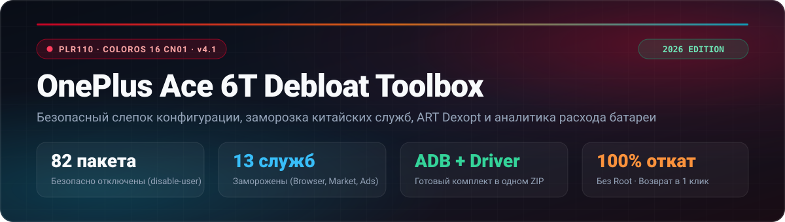
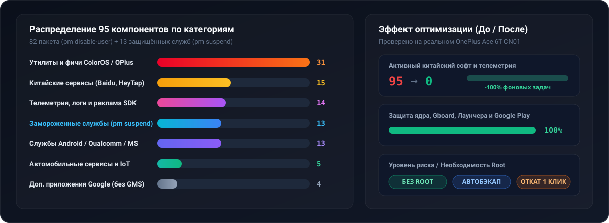
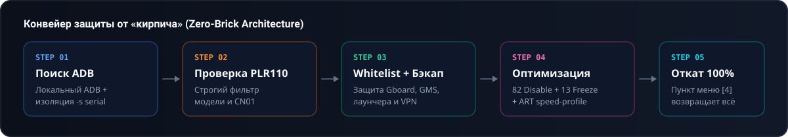

<div align="center">



<br><br>

[](https://github.com/Vektor010/oneplus-ace-6t-debloat/releases/latest)

<br>

[](#)
[](#)
[](https://github.com/Vektor010/oneplus-ace-6t-debloat/releases/latest)
[](#)
[](#)

<br>

[👶 Гайд новичкам](#-установка-и-запуск-для-новичков) &bull; [📊 Графики](#-аналитика-и-безопасность) &bull; [🏝️ Вернуть «Остров» и функции](#️-как-вернуть-нужную-функцию-отдельно) &bull; [📋 Все 95 пакетов](#-справочник-всех-95-пакетов) &bull; [❓ FAQ](#-частые-вопросы)

</div>

---

> [!IMPORTANT]
> **Защита от «кирпича»:** Скрипт работает **без Root**, не трогает `/system` и не удаляет ваши фото и данные. Перед запуском проверяется точная модель **`PLR110`** и регион **`CN01`** — на другом смартфоне скрипт остановится сам.

---

## 📊 Аналитика и безопасность

<p align="center">
  
</p>

<p align="center">
  
</p>

---

## 👶 Установка и запуск для новичков

> [!NOTE]
> **Ничего отдельно искать и скачивать не нужно.** В готовом архиве уже лежат рабочий портативный **ADB** (`platform-tools`), официальный **Google USB Driver** (`Drivers/usb_driver`), лаунчер в 1 клик (`Run_Debloat.bat`) и оффлайн-инструкция (`ИНСТРУКЦИЯ_ДЛЯ_НОВИЧКОВ.txt`).

### 1. Скачайте и распакуйте
Перейдите в [**Releases**](https://github.com/Vektor010/oneplus-ace-6t-debloat/releases/latest), скачайте **`OnePlus_Ace6T_Debloat_Tool.zip`** и распакуйте его в отдельную папку *(правый клик → «Извлечь все...»)*.

### 2. Включите отладку на OnePlus Ace 6T
* Откройте **Настройки** ➔ **Об устройстве** ➔ **Версия** ➔ нажмите **7 раз** по **Номеру сборки**.
* Перейдите в **Настройки** ➔ **Дополнительные настройки** *(или Система и обновления)* ➔ **Для разработчиков**.
* Включите **«Отладка по USB»** и *(рекомендуется)* **«Отключить мониторинг разрешений»**.

### 3. Подключите кабель (и проверьте драйвер)
* Подключите телефон кабелем к ПК, разблокируйте экран и в шторке переключите USB в режим **«Передача файлов»**.
* **На Windows 10 / 11 драйвер уже встроен (`WinUSB`)** — телефон определится сам за 5 секунд.

<details>
<summary>🔌 <b>Если Windows не видит телефон (3 способа установить драйвер)</b></summary>
<br>

1. **Встроенный в телефон драйвер:** откройте «Этот компьютер» ➔ виртуальный CD-диск `OnePlus Drivers` ➔ запустите `OnePlus_USB_Drivers_Setup.exe`.
2. **Официальный драйвер Google (уже в архиве):** `Win + X` ➔ **Диспетчер устройств** ➔ ПКМ по устройству с жёлтым треугольником (`一加 Ace 6T` / `ADB Interface`) ➔ **Обновить драйвер** ➔ **Найти на этом компьютере** ➔ **Выбрать из списка** ➔ **Показать все устройства** ➔ **Установить с диска...** ➔ укажите `Drivers\usb_driver\android_winusb.inf` ➔ выберите **Android ADB Interface**.
3. **Установщик в 1 клик:** скачайте официальный [Universal ADB Driver (.msi)](https://github.com/koush/adb.clockworkmod.com/releases/latest).

</details>

### 4. Запустите в 1 клик
* Откройте распакованную папку и запустите **`Run_Debloat.bat`**.
* **На экране телефона** поставьте галочку *«Всегда разрешать»* и нажмите **«Разрешить»**.
* В меню введите **`1`** ➔ подтвердите **`1`** ➔ дождитесь завершения (~20 сек) и перезагрузите смартфон.

---

## 🏝️ Как вернуть нужную функцию отдельно

Если вы применили полный слепок, но хотите вернуть **только одну функцию** (например, **«Остров»**, **AOD** или **скриншоты**) — откройте папку `platform-tools`, введите `cmd` в адресной строке проводника (`Enter`) и скопируйте нужный блок кнопкой справа сверху.

### 🏝️ Вернуть «Остров» (Fluid Cloud / Живые оповещения / Плеер у камеры)
За работу динамической капсулы вокруг камеры отвечают системная шина `OCS`, контроллер медиа и движок сценариев:

```cmd
adb shell pm enable --user 0 com.coloros.ocs.opencapabilityservice
adb shell pm enable --user 0 com.oplus.smartmediacontroller
adb shell pm enable --user 0 com.oplus.smartengine
adb shell pm enable --user 0 com.oplus.aiwidgets
adb shell pm enable --user 0 com.oplus.metis
adb shell pm enable --user 0 com.coloros.sceneservice
```

> [!TIP]
> После включения пакетов **«Острова»** или **AOD** обязательно перезагрузите смартфон (`adb reboot`).

### 🕒 Вернуть Always-On Display (AOD)

```cmd
adb shell pm enable --user 0 com.oplus.aod
```

### 📸 Вернуть расширенные скриншоты и запись экрана

```cmd
adb shell pm enable --user 0 com.oplus.screenshot
adb shell pm enable --user 0 com.oplus.screenrecorder
```

### 📱 Вернуть Умную боковую панель (Smart Sidebar)

```cmd
adb shell pm enable --user 0 com.coloros.smartsidebar
```

### 🎮 Вернуть Игровой режим (Game Toolkit / Игры)

```cmd
adb shell pm enable --user 0 com.oplus.games
```

<details>
<summary>🔧 <b>Остальные функции (Диктофон, Компас, ИК-пульт, OShare, Android Auto, Gmail, Браузер)</b></summary>
<br>

**🎙️ Диктофон и 🧭 Компас:**
```cmd
adb shell pm enable --user 0 com.coloros.soundrecorder
adb shell pm enable --user 0 com.coloros.compass2
```

**📺 ИК-пульт (ТВ / кондиционер):**
```cmd
adb shell pm enable --user 0 com.oplus.consumerIRApp
```

**👁️ Защита зрения (Eye Comfort):**
```cmd
adb shell pm enable --user 0 com.oplus.eyeprotect
```

**🔄 OShare и 🖥️ Трансляция экрана:**
```cmd
adb shell pm enable --user 0 com.coloros.oshare
adb shell pm enable --user 0 com.coloros.sharescreen
```

**🚗 Android Auto:**
```cmd
adb shell pm enable --user 0 com.google.android.projection.gearhead
```

**📧 Gmail, Google Поиск и Google Объектив (Lens):**
```cmd
adb shell pm enable --user 0 com.google.android.gm
adb shell pm enable --user 0 com.google.android.googlequicksearchbox
adb shell pm enable --user 0 com.google.ar.lens
```

**❄️ Разморозить китайский браузер, App Market или Магазин тем:**
```cmd
adb shell pm unsuspend --user 0 com.heytap.browser
adb shell pm unsuspend --user 0 com.heytap.market
adb shell pm unsuspend --user 0 com.oplus.themestore
```

</details>

---

## 📋 Справочник всех 95 пакетов

Ниже расписан **каждый** пакет из скрипта (82 отключаемых + 13 замораживаемых).  
Метка `🟡` означает, что пакет отвечает за видимую функцию интерфейса (её легко вернуть командами выше).

<details open>
<summary><b>❄️ 13 замороженных служб ColorOS (<code>pm suspend --user 0</code>)</b></summary>
<br>

| Пакет | За что отвечает |
| :--- | :--- |
| `com.heytap.browser` | Встроенный китайский браузер HeyTap с рекламой |
| `com.heytap.market` | Китайский магазин приложений App Market |
| `com.heytap.pictorial` | Карусель обоев экрана блокировки (сильный жор батареи) |
| `com.heytap.quicksearchbox` | Китайская строка поиска на рабочем столе |
| `com.heytap.htms` | Системный транспортный сервис HeyTap |
| `com.opos.ads` | Главный рекламный модуль ColorOS / OPPO Ads |
| `com.coloros.securityguard` | Китайский защитник (мешает установке сторонних APK) |
| `com.nearme.instant.platform` | Платформа мгновенных китайских приложений Quick Apps |
| `com.oplus.themestore` | 🟡 Магазин тем OPlus Theme Store |
| `com.oppo.store` | Фирменный интернет-магазин техники OPPO Store |
| `com.heytap.speechassist` | Китайский голосовой помощник Breeno |
| `com.oplus.ovoicemanager` | Движок распознавания речи Breeno Voice |
| `com.oplus.ovoicemanager.wakeup` | Фоновое прослушивание ключевой фразы Breeno |

</details>

<details>
<summary><b>🎨 31 пакет: Утилиты и функции ColorOS / OPlus (<code>pm disable-user</code>)</b></summary>
<br>

| Пакет | За что отвечает |
| :--- | :--- |
| `com.heytap.colorfulengine` | 🟡 Тяжёлый 3D-движок живых обоев ColorOS (жор GPU/RAM) |
| `com.android.wallpaper.livepicker.overlay` | 🟡 Системный оверлей выбора живых обоев |
| `com.coloros.ocs.opencapabilityservice` | 🟡 **«Остров» (Fluid Cloud)** — системная шина OCS |
| `com.oplus.smartmediacontroller` | 🟡 **«Остров» (Fluid Cloud)** — плеер у камеры и на экране блокировки |
| `com.oplus.smartengine` | 🟡 **«Остров» (Fluid Cloud)** — триггеры и сценарии SmartEngine |
| `com.oplus.aiwidgets` | 🟡 **«Остров» / AI** — умные карточки и виджеты ColorOS |
| `com.oplus.aod` | 🟡 **Always-On Display** — часы на выключенном экране |
| `com.oplus.screenshot` | 🟡 **Скриншоты** — расширенные и длинные скриншоты ColorOS |
| `com.oplus.screenrecorder` | 🟡 **Запись экрана** — встроенный рекордер ColorOS |
| `com.coloros.smartsidebar` | 🟡 **Смарт-панель** — выдвижная боковая панель |
| `com.oplus.games` | 🟡 **Игровой режим** — центр игр и панель Game Toolkit |
| `com.coloros.soundrecorder` | 🟡 **Диктофон** — встроенная запись звука |
| `com.coloros.compass2` | 🟡 **Компас** — встроенное приложение компаса |
| `com.oplus.consumerIRApp` | 🟡 **ИК-пульт** — управление ТВ и кондиционером |
| `com.oplus.eyeprotect` | 🟡 **Защита зрения** — оверлей режима Eye Comfort |
| `com.coloros.oshare` | 🟡 **OShare** — быстрая передача файлов OPPO/OnePlus |
| `com.coloros.sharescreen` | 🟡 **Трансляция экрана** — совместный просмотр экрана |
| `com.oplus.account` | 🟡 Облачный аккаунт HeyTap / OPPO Account |
| `com.coloros.codebook` | Встроенный китайский менеджер паролей Codebook |
| `com.coloros.digitalwellbeing` | Модуль «Цифровое благополучие» ColorOS |
| `com.coloros.karaoke` | Аудио-эффекты микрофона для китайских караоке-приложений |
| `com.coloros.mapcom.frame` | Вспомогательный фреймворк китайских карт |
| `com.coloros.remoteguardservice` | Китайский сервис родительского контроля RemoteGuard |
| `com.coloros.securepay` | Проверка безопасности китайских платёжных приложений |
| `com.coloros.smartlock` | Умная разблокировка ColorOS SmartLock |
| `com.gamma.scan` | Предустановленный китайский сканер документов |
| `com.oplus.melody` | Сервис мелодий и китайской обвязки HeyMelody |
| `com.oplus.ovoicemanager` | Голосовой движок Breeno Voice |
| `com.oplus.ovoicemanager.wakeup` | Пробуждение голосового ассистента Breeno |
| `com.oplus.owork` | Китайский рабочий профиль OWork |
| `com.oplus.phonenoareainquire` | Определение китайских провинций по номеру телефона |

</details>

<details>
<summary><b>🇨🇳 15 пакетов: Китайские сервисы и партнёрский софт (<code>pm disable-user</code>)</b></summary>
<br>

| Пакет | За что отвечает |
| :--- | :--- |
| `com.baidu.searchbox` | Китайский поисковик и браузер Baidu |
| `com.baidu.input_oppo` | Китайская клавиатура Baidu IME *(Gboard защищена)* |
| `com.autonavi.minimap` | Китайские карты и навигатор AutoNavi (Amap) |
| `com.finshell.wallet` | Китайский кошелёк FinShell Wallet / HeyTap Pay |
| `com.unionpay.tsmservice` | Служба бесконтактной оплаты UnionPay TSM |
| `com.heytap.themestore` | Магазин тем HeyTap (legacy-пакет) |
| `com.heytap.music` | Китайский музыкальный сервис HeyTap Music |
| `com.heytap.vip` | Клуб лояльности и подписок HeyTap VIP |
| `com.heytap.yoli` | Китайский видеосервис HeyTap Yoli |
| `com.heytap.accessory` | Менеджер подключения китайских аксессуаров HeyTap |
| `com.heytap.speechassist` | Китайский голосовой ассистент Breeno |
| `com.oppo.store` | Фирменный магазин OPPO Store CN |
| `com.oppo.ctautoregist` | Фоновая авторегистрация SIM China Telecom |
| `com.oppo.instant.local.service` | Локальная служба Quick Apps CN |
| `com.ted.number` | База китайских спам-номеров Ted Number |

</details>

<details>
<summary><b>📡 14 пакетов: Телеметрия, логи и рекламные SDK (<code>pm disable-user</code>)</b></summary>
<br>

| Пакет | За что отвечает |
| :--- | :--- |
| `com.oplus.sauhelper` | Фоновая служба тихих обновлений и телеметрии SAU |
| `com.oplus.logtrial` | Сборщик системных логов и краш-дампов |
| `com.oplus.powermonitor` | Фоновый сборщик статистики расхода и аналитики |
| `com.oplus.atlas` | Диагностическая телеметрия подсистем Atlas |
| `com.oplus.dfs` | Распределённая файловая служба экосистемы OPPO |
| `com.oplus.owkservice` | Фоновая служба синхронизации и пробуждения OWK |
| `com.oplus.sos` | Региональные экстренные вызовы SOS (CN) |
| `com.oplus.stdsp` | Вспомогательная служба DSP-аналитики |
| `com.oplus.subsys` | Сервисный демон мониторинга подсистем Subsys |
| `com.oplus.vdc` | Контроллер виртуальных дисплеев VDC |
| `com.qti.dcf` | Телеметрия чипсета Qualcomm DCF |
| `com.android.adservices.api` | Рекламное API Android Privacy Sandbox |
| `com.android.federatedcompute.services` | Фоновое федеративное обучение (ML-аналитика) |
| `com.android.ondevicepersonalization.services` | Персонализация рекламы на устройстве |

</details>

<details>
<summary><b>🚗 5 пакетов: Автомобильные сервисы и IoT (<code>pm disable-user</code>)</b></summary>
<br>

| Пакет | За что отвечает |
| :--- | :--- |
| `com.heytap.opluscarlink` | Подключение к мультимедиа китайских авто CarLink |
| `com.oplus.ocar` | Автомобильная оболочка OCar |
| `com.oplus.cardigitalkey` | Цифровой NFC/BLE-ключ для китайских авто |
| `com.oplus.viewtalk` | Видеосвязь и вывод в авто ViewTalk |
| `com.oplus.travelengine` | Китайский сервис подсказок в поездках (рейсы, отели) |

</details>

<details>
<summary><b>⚙️ 13 пакетов: Редко используемые службы Android / Qualcomm / MS (<code>pm disable-user</code>)</b></summary>
<br>

| Пакет | За что отвечает |
| :--- | :--- |
| `andes.oplus.documentsreader` | Встроенный просмотрщик документов Andes |
| `com.android.cellbroadcastreceiver` | Широковещательные оповещения ЧС (Cell Broadcast) |
| `com.android.cts.priv.ctsshim` | Заводской тестовый модуль Compatibility Test Suite |
| `com.android.DeviceAsWebcam` | 🟡 Использование смартфона как USB веб-камеры для ПК |
| `com.android.dynsystem` | Загрузчик тестовых динамических образов DSU |
| `com.android.healthconnect.controller` | 🟡 Агрегатор фитнес-данных Health Connect |
| `com.android.hotspot2.osulogin` | Авторизация корпоративных сетей Wi-Fi Passpoint |
| `com.android.musicfx` | Устаревший системный эквалайзер AOSP MusicFX |
| `com.android.printspooler` | 🟡 Служба сетевой печати на принтеры |
| `com.android.simappdialog` | Меню оператора SIM Toolkit (часто шлёт спам) |
| `com.android.virtualization.terminal` | Виртуальный Linux-терминал Android Virtualization |
| `com.microsoftsdk.crossdeviceservicebroker` | 🟡 Фоновый брокер «Связь с Windows» от Microsoft |
| `com.qualcomm.qti.powersavemode` | Устаревший модуль энергосбережения Qualcomm |

</details>

<details>
<summary><b>🌐 4 пакета: Доп. приложения Google (Play Market и GMS НЕ тронуты)</b></summary>
<br>

| Пакет | За что отвечает |
| :--- | :--- |
| `com.google.android.gm` | 🟡 Почтовый клиент Gmail |
| `com.google.android.googlequicksearchbox` | 🟡 Приложение «Google Поиск» и виджет поиска |
| `com.google.android.projection.gearhead` | 🟡 **Android Auto** (подключение к магнитоле авто) |
| `com.google.ar.lens` | 🟡 Поиск по камере Google Объектив (Lens) |

</details>

---

## ❓ Частые вопросы

<details>
<summary><b>Как полностью откатить всё обратно?</b></summary>
<br>
Запустите <code>Run_Debloat.bat</code> ➔ выберите пункт <b>[4] Полный откат</b> ➔ подтвердите цифрой <b>1</b>. Все 82 отключённых и 13 замороженных пакетов мгновенно вернутся в исходное состояние.
</details>

<details>
<summary><b>Не сломается ли Google Play, связь или уведомления?</b></summary>
<br>
Нет. <code>com.google.android.gms</code> (Google Play Services), <code>com.android.vending</code> (Google Play), активная клавиатура, лаунчер, телефония и VPN находятся в жёстком белом списке и защищены на уровне кода.
</details>

<details>
<summary><b>Как посмотреть, какое приложение жрёт батарею?</b></summary>
<br>
Выберите в меню пункт <b>[3] Анализ расхода батареи</b> — скрипт прочитает <code>dumpsys batterystats</code> и выведет ТОП-15 потребителей энергии в <b>мА·ч (mAh)</b> с подсветкой фоновых мессенджеров и маркетплейсов.
</details>

---

<div align="center">

<sub><b>OnePlus Ace 6T (PLR110 · ColorOS 16 CN01)</b> &bull; By <b>Vektor010</b> &bull; Лицензия MIT &bull; 2026</sub>

</div>
