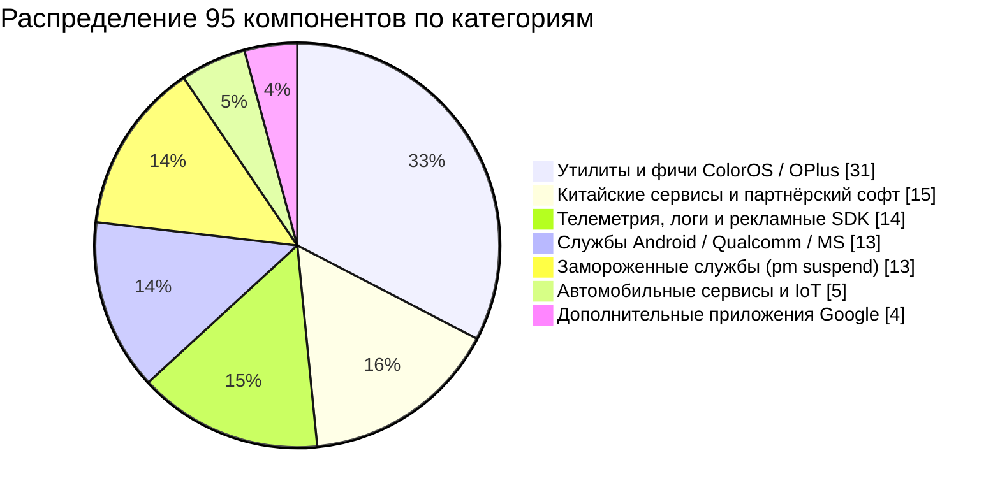
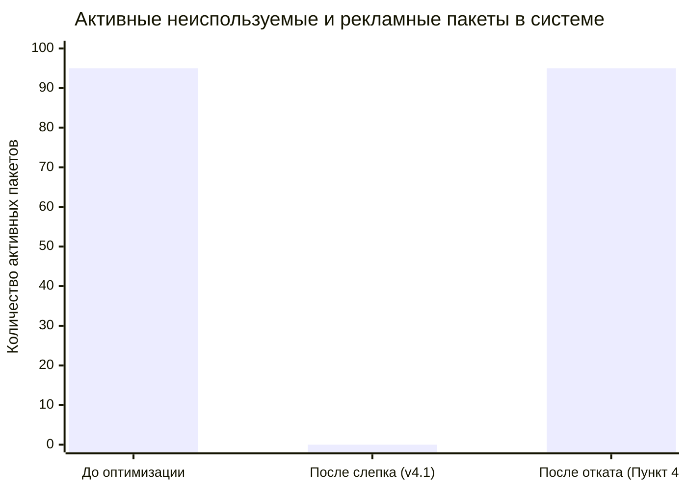
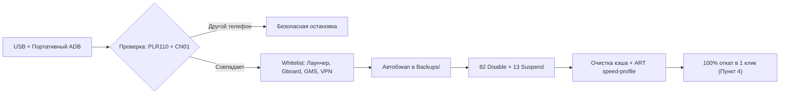

<div align="center">

# ⚡ OnePlus Ace 6T · ColorOS 16 CN Toolbox

**Безопасный деблоат, глубокая заморозка китайских служб, ART-компиляция и аналитика расхода батареи**  
*Точная репликация проверенной рабочей конфигурации `PLR110` (`ColorOS 16 CN01`) без Root и с откатом в 1 клик*

<br>

[](https://github.com/Vektor010/oneplus-ace-6t-debloat/releases/latest)

<br>


<br>

[👶 Гайд для новичков](#-инструкция-для-новичков-за-5-минут) · [📊 Графики и архитектура](#-графики-и-архитектура-оптимизации) · [🏝️ Как вернуть «Остров» и функции](#️-как-вернуть-нужную-функцию-отдельно) · [📋 Все 95 пакетов](#-полный-справочник-всех-95-пакетов) · [❓ FAQ](#-частые-вопросы-faq)

</div>

---

> [!IMPORTANT]
> **Строгая защита от «кирпича»:** Скрипт автоматически проверяет `ro.product.model == PLR110` и регион `CN01`. Если подключён другой смартфон, утилита остановится и не внесёт ни одного изменения. Системный раздел `/system` не затрагивается, личные данные и фото остаются в полной сохранности.

---

## 📊 Графики и архитектура оптимизации

### 1. Структура оптимизируемых компонентов (82 отключённых + 13 замороженных)



### 2. Активные фоновые мусорные модули: «До» и «После» слепка



### 3. Конвейер безопасности и обратимости



---

## 🏝️ Как вернуть нужную функцию отдельно

Если вы применили полный слепок, но хотите вернуть **только одну конкретную функцию** (например, **«Остров» / Fluid Cloud**, **AOD**, **скриншоты** или **боковую панель**) — не нужно откатывать весь скрипт.

Просто откройте папку `platform-tools` из архива (введите `cmd` в адресной строке проводника и нажмите `Enter`) и выполните нужную команду:

| Функция на телефоне | Какие пакеты отвечают | Готовая команда для возврата (скопируйте и вставьте) |
| :--- | :--- | :--- |
| **🏝️ «Остров» (Fluid Cloud / Живые оповещения / Плеер у камеры)** | `com.coloros.ocs.opencapabilityservice`<br>`com.oplus.smartmediacontroller`<br>`com.oplus.smartengine`<br>`com.oplus.aiwidgets` *(+ `com.oplus.metis`, `com.coloros.sceneservice`)* | `adb shell pm enable --user 0 com.coloros.ocs.opencapabilityservice && adb shell pm enable --user 0 com.oplus.smartmediacontroller && adb shell pm enable --user 0 com.oplus.smartengine && adb shell pm enable --user 0 com.oplus.aiwidgets && adb shell pm enable --user 0 com.oplus.metis && adb shell pm enable --user 0 com.coloros.sceneservice` |
| **🕒 Always-On Display (AOD / Экран всегда включён)** | `com.oplus.aod` | `adb shell pm enable --user 0 com.oplus.aod` |
| **📸 Расширенные скриншоты и запись экрана** | `com.oplus.screenshot`<br>`com.oplus.screenrecorder` | `adb shell pm enable --user 0 com.oplus.screenshot && adb shell pm enable --user 0 com.oplus.screenrecorder` |
| **📱 Умная боковая панель (Smart Sidebar)** | `com.coloros.smartsidebar` | `adb shell pm enable --user 0 com.coloros.smartsidebar` |
| **🎮 Игровой режим (Game Toolkit / Игры)** | `com.oplus.games` | `adb shell pm enable --user 0 com.oplus.games` |
| **🎙️ Диктофон и 🧭 Компас** | `com.coloros.soundrecorder`<br>`com.coloros.compass2` | `adb shell pm enable --user 0 com.coloros.soundrecorder && adb shell pm enable --user 0 com.coloros.compass2` |
| **📺 ИК-пульт (управление ТВ / кондиционером)** | `com.oplus.consumerIRApp` | `adb shell pm enable --user 0 com.oplus.consumerIRApp` |
| **👁️ Защита зрения (Eye Comfort)** | `com.oplus.eyeprotect` | `adb shell pm enable --user 0 com.oplus.eyeprotect` |
| **🔄 OShare и 🖥️ Трансляция экрана** | `com.coloros.oshare`<br>`com.coloros.sharescreen` | `adb shell pm enable --user 0 com.coloros.oshare && adb shell pm enable --user 0 com.coloros.sharescreen` |
| **🚗 Android Auto** | `com.google.android.projection.gearhead` | `adb shell pm enable --user 0 com.google.android.projection.gearhead` |
| **📧 Gmail / Google Поиск / Google Lens** | `com.google.android.gm`<br>`com.google.android.googlequicksearchbox`<br>`com.google.ar.lens` | `adb shell pm enable --user 0 com.google.android.gm && adb shell pm enable --user 0 com.google.android.googlequicksearchbox && adb shell pm enable --user 0 com.google.ar.lens` |
| **🌐 Китайский браузер / App Market / Темы** *(были заморожены)* | `com.heytap.browser`<br>`com.heytap.market`<br>`com.oplus.themestore` | `adb shell pm unsuspend --user 0 com.heytap.browser` *(замените имя пакета на нужное)* |

> [!TIP]
> После возврата системных UI-компонентов (особенно **«Острова»** или **AOD**) обязательно **перезагрузите смартфон**, чтобы ColorOS подхватила службы при старте.

---

## 👶 Инструкция для новичков (за 5 минут)

> [!NOTE]
> **Всё уже внутри готового архива:** рабочий портативный **ADB** (`platform-tools`), официальный подписанный **Google USB Driver** (`Drivers/usb_driver`), лаунчер в 1 клик (`Run_Debloat.bat`) и оффлайн-гайд (`ИНСТРУКЦИЯ_ДЛЯ_НОВИЧКОВ.txt`). Ничего отдельно искать не нужно.

### Шаг 1. Скачайте и распакуйте архив
1. Перейдите в [**Releases**](https://github.com/Vektor010/oneplus-ace-6t-debloat/releases/latest) и скачайте **`OnePlus_Ace6T_Debloat_Tool.zip`**.
2. Нажмите правой кнопкой мыши по архиву → **«Извлечь все...»** в отдельную папку.
   *(Не запускайте `Run_Debloat.bat` прямо внутри окна WinRAR/7-Zip — сначала обязательно распакуйте!)*

### Шаг 2. Подготовьте смартфон OnePlus Ace 6T
1. Откройте **Настройки** → **Об устройстве** (*About device*) → **Версия** (*Version*).
2. Нажмите **7 раз подряд** на **Номер сборки** (*Build number*) и введите PIN-код/пароль.
3. Вернитесь в **Настройки** → **Дополнительные настройки** *(или Система и обновления)* → **Для разработчиков** (*Developer options*).
4. Включите **«Отладка по USB»** (*USB debugging*).
5. *(Рекомендуется для ColorOS)* Ниже в том же меню включите **«Отключить мониторинг разрешений»** (*Disable permission monitoring*).

### Шаг 3. Подключите к ПК и проверьте драйвер
1. Подключите OnePlus Ace 6T к ПК кабелем USB (желательно родным) и разблокируйте экран.
2. В шторке уведомлений переключите режим USB на **«Передача файлов»** *(не «Только зарядка»)*.
3. **Драйвер:**
   - **Windows 10 / 11:** драйвер `WinUSB` уже встроен в Windows — в 95% случаев телефон определится сам за 5 секунд.
   - **Если ПК не видит смартфон:**
     - *Способ 1:* Откройте «Этот компьютер» → виртуальный CD-диск `OnePlus Drivers` → запустите `OnePlus_USB_Drivers_Setup.exe`.
     - *Способ 2 (драйвер уже в архиве):* Нажмите `Win + X` → **Диспетчер устройств** → правый клик по устройству с жёлтым треугольником (`一加 Ace 6T` / `ADB Interface`) → **Обновить драйвер** → **Найти драйверы на этом компьютере** → **Выбрать драйвер из списка** → **Показать все устройства** → **Установить с диска...** → выберите `Drivers\usb_driver\android_winusb.inf` → **Android ADB Interface**.
     - *Способ 3:* Установите [Universal ADB Driver (.msi)](https://github.com/koush/adb.clockworkmod.com/releases/latest) («Далее → Далее → Готово»).

### Шаг 4. Запустите и примените настройки
1. Дважды кликните по **`Run_Debloat.bat`**. *(При окне SmartScreen нажмите «Подробнее» → «Выполнить в любом случае»).*
2. **Посмотрите на экран телефона!** В окне **«Разрешить отладку по USB?»** поставьте галочку **`[✓] Всегда разрешать`** и нажмите **«Разрешить»**.
3. Если программа написала «не авторизован», нажмите **`Enter`** на клавиатуре.
4. В главном меню введите **`1`** → подтвердите **`1`**.
5. По завершении (~20–30 сек) согласитесь на ART-оптимизацию (`1`) и перезагрузку (`1`).

---

## 📋 Полный справочник всех 95 пакетов

> **Обозначения влияния:**  
> 🟢 **Безопасно** — региональный мусор, телеметрия или неиспользуемые службы, на повседневную работу не влияют.  
> 🟡 **Отключает функцию** — убирает конкретную встроенную возможность (при желании возвращается одной командой из таблицы выше).

<details open>
<summary><b>❄️ Замороженные службы ColorOS — 13 пакетов (<code>pm suspend --user 0</code>)</b></summary>
<br>

> Эти компоненты прошивка ColorOS 16 запрещает отключать напрямую через `pm disable-user`, но они безопасно замораживаются через `pm suspend` (процессы полностью остановлены, иконки скрыты).

| № | Имя пакета | За что отвечает | Влияние |
| :-: | :--- | :--- | :---: |
| 1 | `com.heytap.browser` | Встроенный китайский браузер HeyTap с новостной лентой и рекламой | 🟢 Безопасно |
| 2 | `com.heytap.market` | Китайский магазин приложений HeyTap App Market | 🟢 Безопасно |
| 3 | `com.heytap.pictorial` | Карусель рекламных обоев экрана блокировки (активный фоновый жор батареи) | 🟢 Безопасно |
| 4 | `com.heytap.quicksearchbox` | Китайская поисковая строка ColorOS на рабочем столе (свайп вниз) | 🟢 Безопасно |
| 5 | `com.heytap.htms` | Системный транспортный и push-сервис экосистемы HeyTap | 🟢 Безопасно |
| 6 | `com.opos.ads` | Главный рекламный движок ColorOS (OPPO Ads) | 🟢 Безопасно |
| 7 | `com.coloros.securityguard` | Китайский антивирус/защитник (вызывает ложные блокировки сторонних APK) | 🟢 Безопасно |
| 8 | `com.nearme.instant.platform` | Платформа мгновенных китайских мини-приложений Quick Apps | 🟢 Безопасно |
| 9 | `com.oplus.themestore` | Китайский магазин тем оформления OPlus Theme Store | 🟡 Магазин тем |
| 10 | `com.oppo.store` | Фирменный интернет-магазин техники OPPO Store CN | 🟢 Безопасно |
| 11 | `com.heytap.speechassist` | Китайский голосовой ассистент Breeno | 🟢 Безопасно |
| 12 | `com.oplus.ovoicemanager` | Движок распознавания речи для ассистента Breeno Voice | 🟢 Безопасно |
| 13 | `com.oplus.ovoicemanager.wakeup` | Фоновое прослушивание микрофона для активации Breeno голосом | 🟢 Безопасно |

</details>

<details>
<summary><b>🎨 Утилиты, интерфейс и функции ColorOS / OPlus — 31 пакет (<code>pm disable-user</code>)</b></summary>
<br>

| № | Имя пакета | За что отвечает | Влияние |
| :-: | :--- | :--- | :---: |
| 1 | `com.heytap.colorfulengine` | Тяжёлый 3D/OpenGL движок живых обоев ColorOS (сильно грузит GPU и RAM) | 🟡 Живые обои |
| 2 | `com.android.wallpaper.livepicker.overlay` | Системный оверлей выбора живых обоев | 🟡 Живые обои |
| 3 | `com.coloros.ocs.opencapabilityservice` | Системная шина Open Capability Service (используется **«Островом» / Fluid Cloud**) | 🟡 **Остров** |
| 4 | `com.oplus.smartmediacontroller` | Контроллер медиа в **«Острове» (Fluid Cloud)** и на экране блокировки | 🟡 **Остров** |
| 5 | `com.oplus.smartengine` | Движок контекстных сценариев SmartEngine (триггеры карточек и **«Острова»**) | 🟡 **Остров** |
| 6 | `com.oplus.aiwidgets` | AI-виджеты и умные карточки уведомлений ColorOS | 🟡 **Остров / AI** |
| 7 | `com.oplus.aod` | Always-On Display (часы и уведомления на выключенном экране) | 🟡 **AOD** |
| 8 | `com.oplus.screenshot` | Встроенный сервис расширенных и длинных скриншотов ColorOS | 🟡 **Скриншоты** |
| 9 | `com.oplus.screenrecorder` | Встроенная запись видео с экрана ColorOS | 🟡 **Запись экрана** |
| 10 | `com.coloros.smartsidebar` | Выдвижная умная боковая панель быстрого доступа (Smart Sidebar) | 🟡 **Смарт-панель** |
| 11 | `com.oplus.games` | Игровой центр ColorOS Games и боковая шторка Game Toolkit | 🟡 **Игры** |
| 12 | `com.coloros.soundrecorder` | Встроенное приложение «Диктофон» | 🟡 **Диктофон** |
| 13 | `com.coloros.compass2` | Встроенное приложение «Компас» | 🟡 **Компас** |
| 14 | `com.oplus.consumerIRApp` | Приложение ИК-пульта для управления ТВ, кондиционером и техникой | 🟡 **ИК-пульт** |
| 15 | `com.oplus.eyeprotect` | Дополнительный фильтр и оверлей режима защиты зрения | 🟡 **Защита зрения** |
| 16 | `com.coloros.oshare` | Быстрая беспроводная передача файлов OShare между OPPO/OnePlus/Realme | 🟡 **OShare** |
| 17 | `com.coloros.sharescreen` | Трансляция и совместный просмотр экрана ShareScreen | 🟡 **Трансляция** |
| 18 | `com.coloros.codebook` | Встроенный китайский менеджер паролей ColorOS Codebook | 🟢 Безопасно |
| 19 | `com.coloros.digitalwellbeing` | Модифицированный модуль «Цифровое благополучие» ColorOS | 🟢 Безопасно |
| 20 | `com.coloros.karaoke` | Аудио-эффект обратной связи микрофона для китайских караоке-приложений | 🟢 Безопасно |
| 21 | `com.coloros.mapcom.frame` | Вспомогательный картографический фреймворк для китайских карт | 🟢 Безопасно |
| 22 | `com.coloros.remoteguardservice` | Сервис удалённого родительского контроля RemoteGuard CN | 🟢 Безопасно |
| 23 | `com.coloros.securepay` | Модуль проверки среды оплаты китайских платёжных систем SecurePay | 🟢 Безопасно |
| 24 | `com.coloros.smartlock` | Умная разблокировка ColorOS SmartLock | 🟢 Безопасно |
| 25 | `com.gamma.scan` | Предустановленный китайский сканер документов Gamma Scan | 🟢 Безопасно |
| 26 | `com.oplus.account` | Облачный аккаунт HeyTap / OPPO Account (для входа в китайские сервисы) | 🟡 Аккаунт HeyTap |
| 27 | `com.oplus.melody` | Сервис рингтонов и китайской обвязки наушников HeyMelody | 🟢 Безопасно |
| 28 | `com.oplus.ovoicemanager` | Голосовой движок ассистента Breeno Voice | 🟢 Безопасно |
| 29 | `com.oplus.ovoicemanager.wakeup` | Пробуждение голосового ассистента Breeno | 🟢 Безопасно |
| 30 | `com.oplus.owork` | Китайский рабочий профиль / корпоративное пространство OWork | 🟢 Безопасно |
| 31 | `com.oplus.phonenoareainquire` | Определение города и провинции для китайских номеров телефонов | 🟢 Безопасно |

</details>

<details>
<summary><b>🇨🇳 Китайские сервисы и партнёрский софт — 15 пакетов (<code>pm disable-user</code>)</b></summary>
<br>

| № | Имя пакета | За что отвечает | Влияние |
| :-: | :--- | :--- | :---: |
| 1 | `com.baidu.searchbox` | Китайский поисковик и браузер Baidu | 🟢 Безопасно |
| 2 | `com.baidu.input_oppo` | Предустановленная китайская клавиатура Baidu IME (Gboard защищена) | 🟢 Безопасно |
| 3 | `com.autonavi.minimap` | Китайские карты и навигатор AutoNavi (Amap) | 🟢 Безопасно |
| 4 | `com.finshell.wallet` | Китайский платёжный кошелёк FinShell Wallet / HeyTap Pay | 🟢 Безопасно |
| 5 | `com.unionpay.tsmservice` | Служба бесконтактной оплаты картами UnionPay TSM | 🟢 Безопасно |
| 6 | `com.heytap.themestore` | Магазин тем HeyTap (старый идентификатор пакета) | 🟢 Безопасно |
| 7 | `com.heytap.music` | Китайский музыкальный стриминг HeyTap Music | 🟢 Безопасно |
| 8 | `com.heytap.vip` | Клуб лояльности и подписок HeyTap VIP | 🟢 Безопасно |
| 9 | `com.heytap.yoli` | Китайский видеосервис и онлайн-кинотеатр HeyTap Yoli | 🟢 Безопасно |
| 10 | `com.heytap.accessory` | Менеджер подключения китайских аксессуаров HeyTap | 🟢 Безопасно |
| 11 | `com.heytap.speechassist` | Китайский голосовой ассистент Breeno | 🟢 Безопасно |
| 12 | `com.oppo.store` | Китайский магазин электроники OPPO Store | 🟢 Безопасно |
| 13 | `com.oppo.ctautoregist` | Фоновая авторегистрация SIM-карты в сети China Telecom | 🟢 Безопасно |
| 14 | `com.oppo.instant.local.service` | Локальный сервис быстрых приложений Quick Apps CN | 🟢 Безопасно |
| 15 | `com.ted.number` | База спам-номеров и определитель китайских компаний Ted Number | 🟢 Безопасно |

</details>

<details>
<summary><b>📡 Телеметрия, фоновые логи и рекламные SDK — 14 пакетов (<code>pm disable-user</code>)</b></summary>
<br>

| № | Имя пакета | За что отвечает | Влияние |
| :-: | :--- | :--- | :---: |
| 1 | `com.oplus.sauhelper` | Служба тихих фоновых обновлений компонентов и телеметрии SAU | 🟢 Безопасно |
| 2 | `com.oplus.logtrial` | Фоновый сборщик системных логов и краш-отчётов (лишняя нагрузка на CPU) | 🟢 Безопасно |
| 3 | `com.oplus.powermonitor` | Фоновый сборщик статистики энергопотребления и отправки аналитики | 🟢 Безопасно |
| 4 | `com.oplus.atlas` | Внутренняя диагностическая телеметрия аудио/подсистем Atlas | 🟢 Безопасно |
| 5 | `com.oplus.dfs` | Распределённая файловая служба синхронизации между устройствами OPPO | 🟢 Безопасно |
| 6 | `com.oplus.owkservice` | Фоновая служба синхронизации и пробуждения процессов OWK | 🟢 Безопасно |
| 7 | `com.oplus.sos` | Региональный модуль экстренных служб SOS для Китая | 🟢 Безопасно |
| 8 | `com.oplus.stdsp` | Вспомогательный модуль DSP-телеметрии | 🟢 Безопасно |
| 9 | `com.oplus.subsys` | Сервисный демон мониторинга подсистем Subsys | 🟢 Безопасно |
| 10 | `com.oplus.vdc` | Контроллер виртуальных дисплеев Virtual Display Controller | 🟢 Безопасно |
| 11 | `com.qti.dcf` | Служба телеметрии и конфигурации чипсета Qualcomm DCF | 🟢 Безопасно |
| 12 | `com.android.adservices.api` | Рекламное API Android Privacy Sandbox (анализ интересов для рекламы) | 🟢 Безопасно |
| 13 | `com.android.federatedcompute.services` | Фоновое федеративное машинное обучение Android | 🟢 Безопасно |
| 14 | `com.android.ondevicepersonalization.services` | Локальная персонализация рекламы на устройстве | 🟢 Безопасно |

</details>

<details>
<summary><b>🚗 Автомобильные сервисы и IoT — 5 пакетов (<code>pm disable-user</code>)</b></summary>
<br>

| № | Имя пакета | За что отвечает | Влияние |
| :-: | :--- | :--- | :---: |
| 1 | `com.heytap.opluscarlink` | Интеграция с мультимедиа китайских автомобилей CarLink | 🟢 Безопасно |
| 2 | `com.oplus.ocar` | Автомобильный режим и оболочка OCar (китайский аналог CarPlay) | 🟢 Безопасно |
| 3 | `com.oplus.cardigitalkey` | Цифровой NFC/Bluetooth ключ для совместимых китайских авто | 🟢 Безопасно |
| 4 | `com.oplus.viewtalk` | Трансляция экрана и видеозвонки в салоне авто ViewTalk | 🟢 Безопасно |
| 5 | `com.oplus.travelengine` | Движок подсказок в путешествиях (китайские билеты, рейсы, отели) | 🟢 Безопасно |

</details>

<details>
<summary><b>⚙️ Редко используемые службы Android / Qualcomm / Microsoft — 13 пакетов (<code>pm disable-user</code>)</b></summary>
<br>

| № | Имя пакета | За что отвечает | Влияние |
| :-: | :--- | :--- | :---: |
| 1 | `andes.oplus.documentsreader` | Встроенный просмотрщик офисных документов Andes | 🟢 Безопасно |
| 2 | `com.android.cellbroadcastreceiver` | Региональные широковещательные оповещения ЧС (Cell Broadcast) | 🟢 Безопасно |
| 3 | `com.android.cts.priv.ctsshim` | Заводской тестовый модуль Android Compatibility Test Suite | 🟢 Безопасно |
| 4 | `com.android.DeviceAsWebcam` | Режим использования смартфона как USB веб-камеры для ПК | 🟡 USB-вебкамера |
| 5 | `com.android.dynsystem` | Загрузчик тестовых динамических образов прошивок (DSU) | 🟢 Безопасно |
| 6 | `com.android.healthconnect.controller` | Системный агрегатор фитнес-данных Health Connect | 🟡 Health Connect |
| 7 | `com.android.hotspot2.osulogin` | Авторизация корпоративных сетей Wi-Fi Passpoint / Hotspot 2.0 | 🟢 Безопасно |
| 8 | `com.android.musicfx` | Базовый устаревший эквалайзер AOSP MusicFX | 🟢 Безопасно |
| 9 | `com.android.printspooler` | Служба сетевой печати документов на принтеры (Print Spooler) | 🟡 Печать |
| 10 | `com.android.simappdialog` | Всплывающее меню оператора SIM Toolkit (часто рассылает рекламу) | 🟢 Безопасно |
| 11 | `com.android.virtualization.terminal` | Встроенный виртуальный Linux-терминал Android Virtualization | 🟢 Безопасно |
| 12 | `com.microsoftsdk.crossdeviceservicebroker` | Фоновый брокер службы «Связь с Windows» от Microsoft | 🟡 Связь с ПК |
| 13 | `com.qualcomm.qti.powersavemode` | Устаревший профиль энергосбережения Qualcomm | 🟢 Безопасно |

</details>

<details>
<summary><b>🌐 Дополнительные приложения Google — 4 пакета (Play Market и GMS НЕ тронуты!)</b></summary>
<br>

| № | Имя пакета | За что отвечает | Влияние |
| :-: | :--- | :--- | :---: |
| 1 | `com.google.android.gm` | Почтовый клиент Gmail | 🟡 Gmail |
| 2 | `com.google.android.googlequicksearchbox` | Приложение «Google Поиск» и строка поиска | 🟡 Google Поиск |
| 3 | `com.google.android.projection.gearhead` | Автомобильный интерфейс **Android Auto** | 🟡 **Android Auto** |
| 4 | `com.google.ar.lens` | Поиск и перевод по камере **Google Объектив (Lens)** | 🟡 Google Lens |

</details>

---

## 📦 Что внутри архива и меню программы

| Файл / Папка в архиве | Описание |
| :--- | :--- |
| **`Run_Debloat.bat`** | Запуск в 1 клик (строгий `CRLF`, обход `ExecutionPolicy`, UTF-8) |
| **`OnePlus_Ace6T_Clone_Debloat.ps1`** | Скрипт v4.1: изоляция от эмуляторов (`-s <serial>`), Whitelist, бэкап, откат, анализ батареи |
| **`platform-tools/`** | Готовый портативный **ADB** (`adb.exe`, `AdbWinApi.dll`, `AdbWinUsbApi.dll`) |
| **`Drivers/usb_driver/`** | Официальный подписанный **Google USB Driver** |
| **`ИНСТРУКЦИЯ_ДЛЯ_НОВИЧКОВ.txt`** | Подробная оффлайн-инструкция для Блокнота |
| **`disabled_packages_list.txt`** | Справочный текстовый каталог всех пакетов |

```text
======================================================================
   ONEPLUS ACE 6T (PLR110) - COLOROS 16 CN01 TOOLBOX
======================================================================
 Выберите действие:
 [1] Применить слепок автора (Отключить 82 пакета + Заморозить 13 пакетов)
 [2] Оптимизация приложений (ART Dexopt) и безопасная очистка кэша
 [3] Анализ расхода батареи (Поиск фонового жора и Top App Drain)
 [4] Полный откат (Включить 82 пакета + Разморозить 13 пакетов)
 [5] Диагностика состояния устройства (версия, заряд, память)
 [6] Перезагрузить устройство
 [0] Выход
```

---

## ❓ Частые вопросы (FAQ)

<details>
<summary><b>Телефон не превратится в «кирпич»? Фото и данные сохранятся?</b></summary>
<br>
Да, данные, фото, чаты и аккаунты полностью сохраняются. Скрипт работает без Root и не изменяет <code>/system</code>. Активный рабочий стол, клавиатура, связь, <code>com.google.android.gms</code> (Google Play Services), <code>com.android.vending</code> (Play Маркет) и VPN защищены жёстким белым списком.
</details>

<details>
<summary><b>Как полностью откатить изменения, если я передумал?</b></summary>
<br>
Запустите <code>Run_Debloat.bat</code>, выберите пункт <code>[4] Полный откат</code> и подтвердите (<code>1</code>). Все 82 отключённых и 13 замороженных пакетов мгновенно вернутся в заводское состояние.
</details>

<details>
<summary><b>Как узнать, какое приложение реально сажает аккумулятор?</b></summary>
<br>
Выберите в меню пункт <code>[3] Анализ расхода батареи</code>. Скрипт считает системную статистику <code>dumpsys batterystats</code>, сопоставит UID с реальными пакетами и выведет ТОП-15 потребителей энергии в <b>мА·ч (mAh)</b>.
</details>

---

<div align="center">

<sub>Инструмент протестирован строго на <b>OnePlus Ace 6T (PLR110 · ColorOS 16 CN01)</b> · Лицензия MIT · 2026</sub>

</div>
