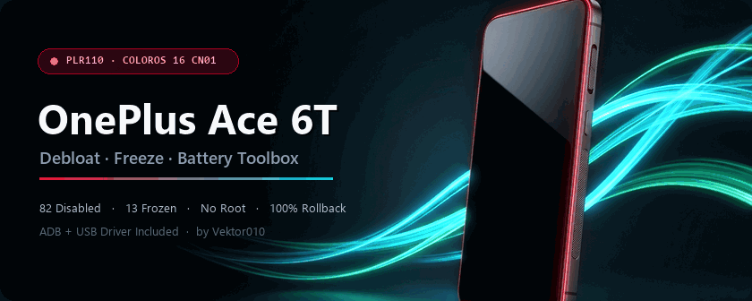

<p align="right">
  <a href="README.md"><b>English Version 🇺🇸</b></a> &bull; <b>Русская версия 🇷🇺</b>
</p>

<p align="center">
  
</p>

<p align="center">
  
</p>

<h1 align="center">⚡ AceDebloat: OnePlus Ace 6T (PLR110) Debloat &amp; Optimization</h1>

<p align="center">
  <b>Безопасная очистка смартфона от китайского софта, заморозка неудаляемых служб и анализ расхода батареи.</b><br/>
  <i>Для OnePlus Ace 6T (ColorOS 16 / 17 CN) · Двуязычный интерфейс (RU/EN) · Без Root · 100% обратимо · ADB и драйверы уже внутри архива. By <b>Vektor010</b>.</i>
</p>

<p align="center">
  <a href="https://github.com/Vektor010/oneplus-ace-6t-debloat/releases/latest"></a>&nbsp;&nbsp;
  <a href="#-важное-уточнение-что-отключается-а-что-замораживается"></a>&nbsp;&nbsp;
  <a href="#-быстрый-старт-за-3-шага-для-новичков"></a>&nbsp;&nbsp;
  <a href="#-полный-справочник-всех-95-пакетов"></a>
</p>

<p align="center">
  
  
  
  
  
</p>

---

## 🛡️ Важное уточнение: что отключается, а что замораживается

> [!IMPORTANT]
> **СКРИПТ НИЧЕГО НЕ УДАЛЯЕТ С ТЕЛЕФОНА (команда `pm uninstall` НЕ используется).**  
> Все APK-файлы прошивки остаются нетронутыми в разделе `/system`. Все действия выполняются только на уровне пользователя (`--user 0`) и **на 100% обратимы в 1 клик** через пункт меню **`[5]`**.

| Механизм | Кол-во | Команды ADB | Зачем и как это работает | Откат? |
| :--- | :---: | :--- | :--- | :--- |
| **1. Отключение** *(Disable)* | **82** | `pm disable-user --user 0 <пакет>` | Переводит пакет в состояние `enabled=2`. Иконка скрывается, фоновые процессы не запускаются. | ✅ **Да** (`pm enable --user 0`) |
| **2. Заморозка** *(Suspend + AppOps)* | **13** | `pm suspend --user 0 <пакет>` + `cmd appops set ... ignore` | ColorOS запрещает отключать защищённые пакеты (`com.heytap.market`, `com.heytap.browser`, `com.opos.ads`, Breeno) через `disable-user`. Команда `pm suspend` безопасно усыпляет их (`suspended=true`), а `appops` отбирает права на фон, уведомления и автозапуск. | ✅ **Да** (`pm unsuspend` + полный сброс `appops` в `default`) |
| **3. Удаление** *(Uninstall)* | **0** | *(Не применяется)* | Позволяет избежать ошибок `DELETE_FAILED_INTERNAL_ERROR` и сохранить 100% работоспособность OTA-обновлений. | — |

---

## 💡 Зачем это нужно? (Было / Стало)

| До оптимизации (Заводская прошивка) | После оптимизации этим инструментом |
| :--- | :--- |
| ❌ **~140 фоновых процессов**, нагружающих память и процессор | ✅ **95 китайских и телеметрийных пакета безопасно остановлены** |
| ❌ **Утечка батареи ночью (8–12%)** из-за постоянных запросов в Китай | ✅ **Расход ночью 1–2%**: телефон честно спит в Deep Sleep |
| ❌ Китайские всплывающие пуши, реклама в шторке и меню | ✅ **Полная тишина**: реклама Oppo Ads и Breeno заморожены |
| ❌ Перехватчик `appdetail` требует китайский пароль при установке APK | ✅ **Мгновенная чистая установка APK** напрямую через систему |
| ❌ Программа зависала или падала без скачанного ADB / на других версиях | ✅ **Движок v5.0**: автоскачивание ADB, поддержка ColorOS 16/17, асинхронный ADB без зависаний |

---

## 🚀 Быстрый старт за 3 шага (для новичков)

> [!NOTE]
> **Скачайте готовый архив [`OnePlus_Ace6T_Debloat_Tool.zip`](https://github.com/Vektor010/oneplus-ace-6t-debloat/releases/latest)** (внутри уже есть портативный ADB и драйвер Google).  
> *Даже если вы скачали исходники через зелёную кнопку `Code -> Download ZIP` без `platform-tools`, скрипт сам предложит скачать официальный ADB от Google нажатием одной клавиши **`1`**!*

### Шаг 1. Скачайте и распакуйте архив
1. Скачайте [**`OnePlus_Ace6T_Debloat_Tool.zip`**](https://github.com/Vektor010/oneplus-ace-6t-debloat/releases/latest) и **полностью распакуйте** в отдельную папку *(Правый клик ➔ «Извлечь все...»)*. Не запускайте внутри WinRAR / 7-Zip.

### Шаг 2. Включите отладку по USB на телефоне
1. Откройте **Настройки** ➔ **Об устройстве** ➔ **Версия** ➔ нажмите **7 раз** на **«Номер сборки»**.
2. Откройте **Настройки** ➔ **Дополнительные настройки** ➔ **Для разработчиков**.
3. Включите **«Отладка по USB»** и *(рекомендуется)* **«Отключить мониторинг разрешений»**.

### Шаг 3. Подключите к ПК и запустите `Run_Debloat.bat`
1. Подключите телефон кабелем USB-C, разблокируйте экран и в шторке выберите режим USB **«Передача файлов»**.
2. Запустите **`Run_Debloat.bat`** двойным кликом *(при окне SmartScreen нажмите «Подробнее» ➔ «Выполнить в любом случае»)*.
3. **На экране смартфона** отметьте *«Всегда разрешать с этого компьютера»* и нажмите **«Разрешить»**.
4. В меню нажмите **`1`** ➔ подтвердите цифрой **`1`**. Через ~20 секунд всё будет готово.

<details>
<summary><b>Что делать, если компьютер не видит телефон (Установка драйвера)</b></summary>
<br>

На Windows 10 и 11 драйвер (`WinUSB`) уже встроен. Если телефон не определяется:
1. Откройте «Этот компьютер» ➔ виртуальный CD-привод `OnePlus Drivers` ➔ запустите `OnePlus_USB_Drivers_Setup.exe`.
2. Либо: `Win + X` ➔ **Диспетчер устройств** ➔ ПКМ по устройству с жёлтым треугольником ➔ **Обновить драйвер** ➔ **Найти на этом компьютере** ➔ **Выбрать из списка** ➔ **Установить с диска...** ➔ укажите `Drivers/usb_driver/android_winusb.inf` ➔ **Android ADB Interface**.

</details>

---

## 🛍️ Где безопасно брать приложения (Google Play, RuStore и чистые APK)

1. **Включение Google-сервисов в прошивке:**  
   **Настройки** ➔ **Пользователи и аккаунты** ➔ **Службы Google Mobile (GMS)** ➔ переведите тумблер во **Включено**.
2. **Официальный Google Play Маркет:**  
   Скачайте оригинальный APK (`universal` или `arm64-v8a`, ветка **Release**) с проверенного каталога [**APKMirror — Google Play Store**](https://www.apkmirror.com/apk/google-inc/google-play-store/).
3. **Российские банки и Госуслуги:**  
   * 🇷🇺 **[RuStore (rustore.ru)](https://www.rustore.ru/)** — официальный магазин РФ (СберБанк, Т-Банк, ВТБ, Альфа, Госуслуги, Мир Pay).
4. **Международный софт без вирусов и без Google-аккаунта:**  
   * 🌐 **[Aurora Store](https://auroraoss.com/)** — Open Source клиент Google Play (анонимное скачивание напрямую с серверов Google).
   * 📦 **[F-Droid](https://f-droid.org/)** — каталог свободного ПО без рекламы и слежки.

---

## 🏝️ Как вернуть «Остров» (Fluid Cloud) и другие функции

Запустите **`Run_Debloat.bat`** ➔ нажмите пункт меню **`[2] Восстановить отдельную функцию`**:
* **`[1]`** — **«Остров» (Fluid Cloud)**: плеер, таймер и события у камеры (`ocs`, `smartmediacontroller`, `smartengine`, `aiwidgets`, `metis`, `sceneservice`).
* **`[2]`** — **Always-On Display (AOD)**.
* **`[3]`** — **Скриншоты 3 пальцами и запись экрана**.
* **`[4]`** — **Умная боковая панель (Smart Sidebar)**.
* **`[5]`** — **Игровой режим (Game Toolkit / HyperBoost)**.
* **`[6]`** — **Диктофон и Компас ColorOS**.
* **`[7]`** — **CarLink и авто-сервисы**.
* **`[8]`** — **Разморозка HeyTap Browser / App Market / Theme Store** *(с полным сбросом ограничений AppOps)*.
* **`[9]`** — **Возврат проверки APK (`appdetail`) и облака HeyTap Cloud**.

---

## 🖥️ Интерфейс программы v5.0

```text
======================================================================
   ACEDEBLOAT v5.0  |  ONEPLUS ACE 6T (PLR110)  |  COLOROS 16 / 17    
======================================================================
 >>> ЦЕНТР ОПТИМИЗАЦИИ И ДЕБЛОАТА ONEPLUS ACE 6T
----------------------------------------------------------------------
  Device: OnePlus PLR110 | Build: PLR110_16.0.10.500(CN01) | Android 16
  Safety: Без Root · Ничего не удаляется · 100% обратимо

 [1] Очистить и оптимизировать (Отключить 82 + Заморозить 13 служб)
 [2] Восстановить отдельную функцию (Остров, AOD, Скриншоты, Игры...)
 [3] Ускорение приложений (ART Dexopt) и очистка кэша
 [4] Анализ расхода батареи (Топ-15 приложений в мА·ч)
 [5] Полный откат (Включить и разморозить все 95 пакетов)
 [6] Диагностика устройства (версия, статус пакетов, батарея)
 [7] Перезагрузить смартфон
 [L] Switch Language / Язык: RU -> EN
 [0] Выход
```

---

## 📋 Полный справочник всех 95 пакетов

<details open>
<summary><b>🔒 13 замороженных служб (<code>pm suspend</code> + AppOps Hardening)</b></summary>
<br>

| Пакет | Что это простыми словами | Действие |
| :--- | :--- | :--- |
| `com.heytap.pictorial` | Карусель обоев экрана блокировки (сильный жор батареи) | Заморожен (`pm suspend`) + AppOps `ignore` |
| `com.oplus.themestore` | Фирменный магазин тем OPlus Themes | Заморожен (`pm suspend`) + AppOps `ignore` |
| `com.heytap.market` | Китайский магазин App Market (защищён от disable-user; заморожен) | Заморожен (`pm suspend`) + AppOps `ignore` |
| `com.coloros.securityguard` | Китайский защитник (мешает установке сторонних APK) | Заморожен (`pm suspend`) + AppOps `ignore` |
| `com.heytap.speechassist` | Китайский голосовой ассистент Breeno | Заморожен (`pm suspend`) + AppOps `ignore` |
| `com.opos.ads` | Главный рекламный модуль ColorOS / OPPO Ads | Заморожен (`pm suspend`) + AppOps `ignore` |
| `com.heytap.browser` | Встроенный китайский браузер HeyTap с рекламой | Заморожен (`pm suspend`) + AppOps `ignore` |
| `com.heytap.quicksearchbox` | Китайская строка поиска на рабочем столе | Заморожен (`pm suspend`) + AppOps `ignore` |
| `com.oppo.store` | Фирменный интернет-магазин техники OPPO Store CN | Заморожен (`pm suspend`) + AppOps `ignore` |
| `com.nearme.instant.platform` | Платформа мгновенных китайских приложений Quick Apps | Заморожен (`pm suspend`) + AppOps `ignore` |
| `com.oplus.ovoicemanager.wakeup` | Фоновое прослушивание микрофона для пробуждения Breeno | Заморожен (`pm suspend`) + AppOps `ignore` |
| `com.heytap.htms` | Системный транспортный сервис HeyTap | Заморожен (`pm suspend`) + AppOps `ignore` |
| `com.oplus.ovoicemanager` | Движок распознавания речи Breeno Voice | Заморожен (`pm suspend`) + AppOps `ignore` |

</details>

<details>
<summary><b>⏸️ 82 отключённых пакетов (<code>pm disable-user --user 0</code>)</b></summary>
<br>

| Пакет | Что это простыми словами | Действие |
| :--- | :--- | :--- |
| `com.oplus.appdetail` | Перехватчик установки APK (отправляет в китайский маркет) | Отключён (`pm disable-user`) |
| `com.heytap.cloud` | Китайское облачное хранилище HeyTap Cloud | Отключён (`pm disable-user`) |
| `andes.oplus.documentsreader` | Встроенный просмотрщик документов Andes | Отключён (`pm disable-user`) |
| `com.android.adservices.api` | Рекламное API Android Privacy Sandbox | Отключён (`pm disable-user`) |
| `com.android.cellbroadcastreceiver` | Широковещательные оповещения ЧС (Cell Broadcast) | Отключён (`pm disable-user`) |
| `com.android.cts.priv.ctsshim` | Заводской тестовый пакет совместимости CTS | Отключён (`pm disable-user`) |
| `com.android.DeviceAsWebcam` | Использование смартфона как USB веб-камеры | Отключён (`pm disable-user`) |
| `com.android.dynsystem` | Загрузчик тестовых динамических образов DSU | Отключён (`pm disable-user`) |
| `com.android.federatedcompute.services` | Фоновое федеративное обучение (ML-аналитика) | Отключён (`pm disable-user`) |
| `com.android.healthconnect.controller` | Агрегатор фитнес-данных Health Connect | Отключён (`pm disable-user`) |
| `com.android.hotspot2.osulogin` | Авторизация корпоративных сетей Wi-Fi Passpoint | Отключён (`pm disable-user`) |
| `com.android.musicfx` | Устаревший системный эквалайзер AOSP MusicFX | Отключён (`pm disable-user`) |
| `com.android.ondevicepersonalization.services` | Модуль подбора персонализированной рекламы | Отключён (`pm disable-user`) |
| `com.android.printspooler` | Служба сетевой печати на принтеры | Отключён (`pm disable-user`) |
| `com.android.simappdialog` | Меню оператора SIM Toolkit (источник спама) | Отключён (`pm disable-user`) |
| `com.android.virtualization.terminal` | Экспериментальный Linux-терминал Android Virtualization | Отключён (`pm disable-user`) |
| `com.android.wallpaper.livepicker.overlay` | Системный оверлей выбора живых обоев | Отключён (`pm disable-user`) |
| `com.autonavi.minimap` | Китайские карты и навигатор AutoNavi (Amap) | Отключён (`pm disable-user`) |
| `com.baidu.input_oppo` | Китайская клавиатура Baidu IME (Gboard защищена) | Отключён (`pm disable-user`) |
| `com.baidu.searchbox` | Китайский поисковик и браузер Baidu | Отключён (`pm disable-user`) |
| `com.coloros.codebook` | Встроенный китайский менеджер паролей Codebook | Отключён (`pm disable-user`) |
| `com.coloros.compass2` | Встроенный компас ColorOS (возврат: [2]->[6]) | Отключён (`pm disable-user`) |
| `com.coloros.digitalwellbeing` | Модуль «Цифровое благополучие» (учёт времени) | Отключён (`pm disable-user`) |
| `com.coloros.karaoke` | Эффекты микрофона для китайских караоке-приложений | Отключён (`pm disable-user`) |
| `com.coloros.mapcom.frame` | Вспомогательный фреймворк китайских карт | Отключён (`pm disable-user`) |
| `com.coloros.ocs.opencapabilityservice` | «Остров» (Fluid Cloud) — системная шина OCS (возврат: [2]->[1]) | Отключён (`pm disable-user`) |
| `com.coloros.oshare` | OShare — быстрая передача файлов OPPO/OnePlus | Отключён (`pm disable-user`) |
| `com.coloros.remoteguardservice` | Китайский сервис родительского контроля RemoteGuard | Отключён (`pm disable-user`) |
| `com.coloros.sceneservice` | «Остров» (Fluid Cloud) — обработчик сценариев (возврат: [2]->[1]) | Отключён (`pm disable-user`) |
| `com.coloros.securepay` | Проверка безопасности китайских платёжных систем | Отключён (`pm disable-user`) |
| `com.coloros.sharescreen` | Совместный удалённый просмотр экрана | Отключён (`pm disable-user`) |
| `com.coloros.smartlock` | Устаревший сервис разблокировки ColorOS SmartLock | Отключён (`pm disable-user`) |
| `com.coloros.smartsidebar` | Умная боковая панель Smart Sidebar (возврат: [2]->[4]) | Отключён (`pm disable-user`) |
| `com.coloros.soundrecorder` | Системный диктофон ColorOS (возврат: [2]->[6]) | Отключён (`pm disable-user`) |
| `com.finshell.wallet` | Китайский кошелёк FinShell Wallet / HeyTap Pay | Отключён (`pm disable-user`) |
| `com.gamma.scan` | Предустановленный китайский сканер документов | Отключён (`pm disable-user`) |
| `com.google.android.gm` | Почтовый клиент Gmail (можно скачать из Play Store) | Отключён (`pm disable-user`) |
| `com.google.android.googlequicksearchbox` | Приложение «Google Поиск» и виджет | Отключён (`pm disable-user`) |
| `com.google.android.projection.gearhead` | Android Auto (подключение к магнитоле авто) | Отключён (`pm disable-user`) |
| `com.google.ar.lens` | Поиск по камере Google Объектив (Lens) | Отключён (`pm disable-user`) |
| `com.heytap.accessory` | Менеджер подключения китайских аксессуаров HeyTap | Отключён (`pm disable-user`) |
| `com.heytap.colorfulengine` | Тяжёлый 3D-движок живых обоев (высокий жор GPU/RAM) | Отключён (`pm disable-user`) |
| `com.heytap.music` | Китайский музыкальный сервис HeyTap Music | Отключён (`pm disable-user`) |
| `com.heytap.opluscarlink` | Связь с китайскими авто CarLink (возврат: [2]->[7]) | Отключён (`pm disable-user`) |
| `com.heytap.themestore` | Сервис тем HeyTap Theme Store (legacy) | Отключён (`pm disable-user`) |
| `com.heytap.vip` | Клуб лояльности и подписок HeyTap VIP | Отключён (`pm disable-user`) |
| `com.heytap.yoli` | Китайский видеосервис HeyTap Yoli | Отключён (`pm disable-user`) |
| `com.microsoftsdk.crossdeviceservicebroker` | Фоновый брокер «Связь с Windows» от Microsoft | Отключён (`pm disable-user`) |
| `com.oplus.account` | Китайский облачный аккаунт HeyTap / OPPO | Отключён (`pm disable-user`) |
| `com.oplus.aiwidgets` | «Остров» / AI — умные карточки и виджеты (возврат: [2]->[1]) | Отключён (`pm disable-user`) |
| `com.oplus.aod` | Always-On Display — часы на выключенном экране (возврат: [2]->[2]) | Отключён (`pm disable-user`) |
| `com.oplus.atlas` | Диагностическая телеметрия подсистем Atlas | Отключён (`pm disable-user`) |
| `com.oplus.cardigitalkey` | Цифровой NFC/BLE-ключ для авто (возврат: [2]->[7]) | Отключён (`pm disable-user`) |
| `com.oplus.consumerIRApp` | ИК-пульт управления ТВ и кондиционером | Отключён (`pm disable-user`) |
| `com.oplus.dfs` | Распределённая файловая служба экосистемы OPPO | Отключён (`pm disable-user`) |
| `com.oplus.eyeprotect` | Дополнительный оверлей защиты зрения Eye Comfort | Отключён (`pm disable-user`) |
| `com.oplus.games` | Игровой режим Game Toolkit / HyperBoost (возврат: [2]->[5]) | Отключён (`pm disable-user`) |
| `com.oplus.logtrial` | Постоянный сборщик отладочных логов и дампов | Отключён (`pm disable-user`) |
| `com.oplus.melody` | Китайская обвязка наушников HeyMelody CN | Отключён (`pm disable-user`) |
| `com.oplus.metis` | «Остров» / AI — планировщик контекста Metis (возврат: [2]->[1]) | Отключён (`pm disable-user`) |
| `com.oplus.ocar` | Автомобильная оболочка OCar (возврат: [2]->[7]) | Отключён (`pm disable-user`) |
| `com.oplus.owkservice` | Фоновая служба пробуждения и синхронизации OWK | Отключён (`pm disable-user`) |
| `com.oplus.owork` | Китайский рабочий профиль OWork | Отключён (`pm disable-user`) |
| `com.oplus.phonenoareainquire` | Определение китайских провинций по номеру телефона | Отключён (`pm disable-user`) |
| `com.oplus.powermonitor` | Фоновый сборщик статистики расхода и аналитики | Отключён (`pm disable-user`) |
| `com.oplus.sauhelper` | Фоновая служба тихих обновлений и телеметрии SAU | Отключён (`pm disable-user`) |
| `com.oplus.screenrecorder` | Встроенная запись экрана ColorOS (возврат: [2]->[3]) | Отключён (`pm disable-user`) |
| `com.oplus.screenshot` | Скриншоты 3 пальцами и длинные скриншоты (возврат: [2]->[3]) | Отключён (`pm disable-user`) |
| `com.oplus.smartengine` | «Остров» (Fluid Cloud) — движок сценариев (возврат: [2]->[1]) | Отключён (`pm disable-user`) |
| `com.oplus.smartmediacontroller` | «Остров» (Fluid Cloud) — плеер у выреза камеры (возврат: [2]->[1]) | Отключён (`pm disable-user`) |
| `com.oplus.sos` | Региональные экстренные вызовы SOS (Китай) | Отключён (`pm disable-user`) |
| `com.oplus.stdsp` | Вспомогательная служба DSP-аналитики | Отключён (`pm disable-user`) |
| `com.oplus.subsys` | Сервисный демон мониторинга подсистем Subsys | Отключён (`pm disable-user`) |
| `com.oplus.travelengine` | Китайский сервис подсказок в поездках | Отключён (`pm disable-user`) |
| `com.oplus.vdc` | Контроллер виртуальных дисплеев VDC | Отключён (`pm disable-user`) |
| `com.oplus.viewtalk` | Видеосвязь и трансляция в авто ViewTalk | Отключён (`pm disable-user`) |
| `com.oppo.ctautoregist` | Фоновая авторегистрация SIM China Telecom | Отключён (`pm disable-user`) |
| `com.oppo.instant.local.service` | Локальная служба Quick Apps CN | Отключён (`pm disable-user`) |
| `com.qti.dcf` | Телеметрия чипсета Qualcomm DCF | Отключён (`pm disable-user`) |
| `com.qualcomm.qti.powersavemode` | Устаревший модуль энергосбережения Qualcomm | Отключён (`pm disable-user`) |
| `com.ted.number` | База китайских спам-номеров Ted Number | Отключён (`pm disable-user`) |
| `com.unionpay.tsmservice` | Служба бесконтактной оплаты UnionPay TSM | Отключён (`pm disable-user`) |

</details>

---

## ❓ Частые вопросы и документация

* **Приходят ли OTA-обновления?** Да, 100% — система `/system` не меняется.
* **Сохранятся ли фото и приложения?** Да, личные данные в `/data/media` не затрагиваются.
* **Траблшутинг и ошибки:** [`docs/guides/KNOWN_ISSUES.md`](docs/guides/KNOWN_ISSUES.md)
* **Архитектура и отчёты:** [`docs/architecture/ARCHITECTURE.md`](docs/architecture/ARCHITECTURE.md) &bull; [`docs/project/PROJECT_STATE.md`](docs/project/PROJECT_STATE.md)
* **Лицензия:** [`LICENSE`](LICENSE) (MIT).
